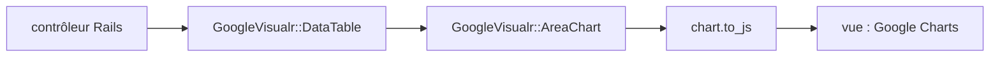

# winston/google_visualr

> Gem Ruby qui génère des graphiques Google Charts sans écrire de JavaScript, pour applications Rails ou Sinatra.

## Le problème
Intégrer Google Charts dans une application Ruby oblige à écrire du JavaScript dans les vues.

## Ce que ça fait vraiment
Fournit des classes Ruby (`DataTable`, `AreaChart`…) dont les options reprennent celles de Google. L'appel `chart.to_js(div_id)` produit le JavaScript injecté dans la vue. On peut régler version, langue et mode Material. Les méthodes et événements de Google ne sont pas couverts.

## Comment c'est branché
Schéma simplifié d'après la fiche, sans diagramme fourni.



## Essayer
```ruby
gem "google_visualr", ">= 2.5"
```
```ruby
data_table = GoogleVisualr::DataTable.new
@chart = GoogleVisualr::Interactive::AreaChart.new(data_table, { width: 400, height: 240, title: 'Company Performance' })
```

## Coût et pièges
Nécessite Ruby et Rails 3/4 d'après le README, ainsi que le chargement de Google Charts côté navigateur. Dernier push en 2021 : probablement non maintenu pour les versions récentes de Rails.

## Ce que ce n'est pas
Pas un outil de visualisation de données pour Python ni un wrapper complet de Google Charts. Les graphiques dépendent d'un service Google chargé à l'exécution.

## Alternatives
Aucune alternative nommée dans le README.

## Pour toi
Ignorer : écosystème Ruby et Rails ancien, sans rapport avec une pile data ou IA en Python.

