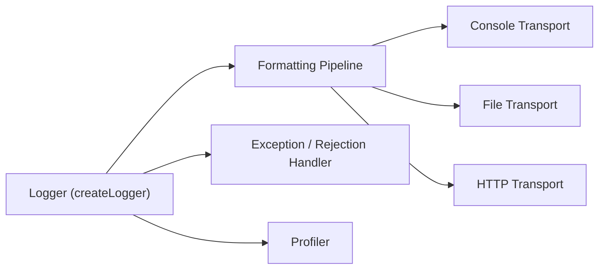

# winstonjs/winston

> Node.js logging library with multiple transports, for developers of Node applications and APIs.

## The problem
Send the logs of a Node app to several destinations, with different levels and formats, without coding each case by hand.

## What it actually does
A logger receives `info` objects (`level`, `message`, metadata) and runs them through formats (via `logform`) before sending them to transports: console, file, HTTP, streams, or community transports. npm or syslog levels, custom levels, child loggers, a logger container, capture of unhandled exceptions and rejections, profiling, log querying.

## How it is wired


## Trying it
```bash
npm install winston
npm test
npm run test:unit
```

## Cost and gotchas
Free. The default logger has no transport: without a transport, the README warns of a risk of high memory usage. `.child` can be a problem if you extend the `Logger` class.

## What it is not
It is not a log aggregation system: it emits logs, it neither stores nor analyzes them.

## Alternatives
No alternative named in the README.

## For you
Keep an eye on it: relevant only if you write Node back-ends; in Python data/MLOps it brings nothing.
