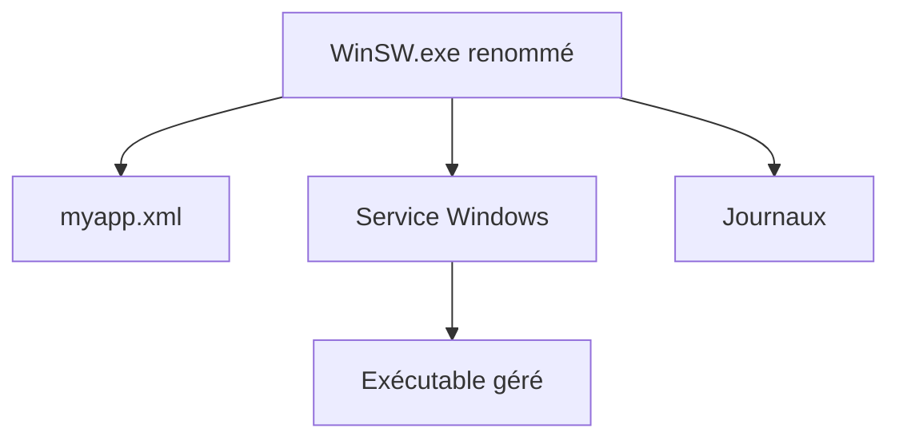

# winsw/winsw

> Windows wrapper that turns any executable into a service, configured by an XML file.

## The problem
Running an application as a Windows service normally requires dedicated code or impractical tools.

## What it actually does
A renamed binary that reads an XML file placed next to it. It installs, starts, stops, restarts and checks the service, with experimental commands (process tree, forced stop). Logs can rotate. Administrator privileges are required (UAC). The 3.x branch is a pre-release; the NuGet and Maven packages correspond to 2.x.

## How it is wired

Simplified diagram based on the README: no diagram provided.

## Trying it
```bash
winsw install myapp.xml
winsw start myapp.xml
winsw status myapp.xml
```

## Cost and gotchas
Free. Windows only. The mix of stable 2.x and pre-release 3.x versions is worth watching.

## What it is not
Not an orchestrator or a container manager: it wraps a single process. Not available outside Windows.

## Alternatives
- nssm, srvany.exe, srvany-ng, shawl: cited as similar projects, without detailed comparison.

## For you
Worth watching: useful only if you host a service on Windows, with no direct link to data or AI work.
