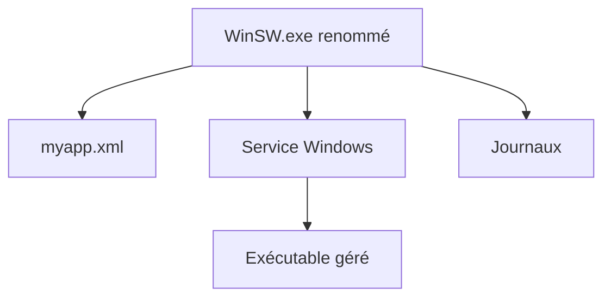

# winsw/winsw

> Enveloppe Windows qui transforme n'importe quel exécutable en service, configurée par un fichier XML.

## Le problème
Lancer une application comme service Windows demande normalement un code dédié ou des outils peu pratiques.

## Ce que ça fait vraiment
Un binaire renommé qui lit un fichier XML placé à côté. Il installe, démarre, arrête, redémarre et vérifie le service, avec des commandes expérimentales (arbre de processus, arrêt forcé). Les journaux peuvent tourner. Les privilèges administrateur sont requis (UAC). La branche 3.x est en pré-version ; les paquets NuGet et Maven correspondent à la 2.x.

## Comment c'est branché

Schéma simplifié d'après le README : aucun diagramme fourni.

## Essayer
```bash
winsw install myapp.xml
winsw start myapp.xml
winsw status myapp.xml
```

## Coût et pièges
Gratuit. Windows uniquement. Mélange de versions 2.x stable et 3.x pré-version à surveiller.

## Ce que ce n'est pas
Pas un orchestrateur ni un gestionnaire de conteneurs : il encapsule un seul processus. Pas disponible hors Windows.

## Alternatives
- nssm, srvany.exe, srvany-ng, shawl : cités comme projets similaires, sans comparaison détaillée.

## Pour toi
À surveiller : utile seulement si tu héberges un service sur Windows, sans lien direct avec le travail data ou IA.

