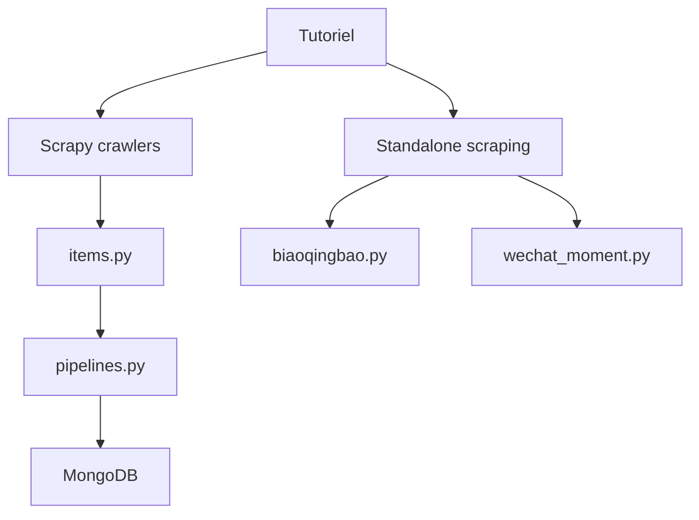

# wistbean/learn_python3_spider

> Series of Chinese-language Python scraping tutorials, with code examples, for beginners.

## The problem
Learning web scraping from scratch, with concrete cases, when you read Chinese and have no guiding thread.

## What it actually does
It is an index of articles (urllib, requests, BeautifulSoup, Selenium, Appium, Scrapy, mitmproxy, MongoDB/MySQL) and a collection of runnable examples, not an application. The code according to the diagram: two Scrapy projects (Qiushibaike, Stack Overflow) whose pipelines write to MongoDB, standalone scripts (books, Douban, memes, slider captcha, WeChat) and pages of gaokao score data. The articles also cover anti-bot circumvention and JS reverse engineering; the README additionally links to a WeChat account and a fitness mini-app (promotion).

## How it is wired

## Trying it
No command documented in the README: it contains only links to articles and sources.

## Cost and gotchas
Free, MIT license. Content in Chinese, written in 2019-2020; the target sites (Douban, Dangdang, etc.) have probably changed their pages, so the examples may no longer run (not verified).

## What it is not
Neither an installable library nor a framework. Not a project maintained as a product: a set of examples by one person. Respecting the terms of use of the targeted sites remains the responsibility of whoever runs the code.

## Alternatives
The README cites no other repo; not documented.

## For you
Ignore: a data/AI profile who reads little Chinese will find better in the official Scrapy or BeautifulSoup documentation, and these dated examples mainly serve as learning material.
