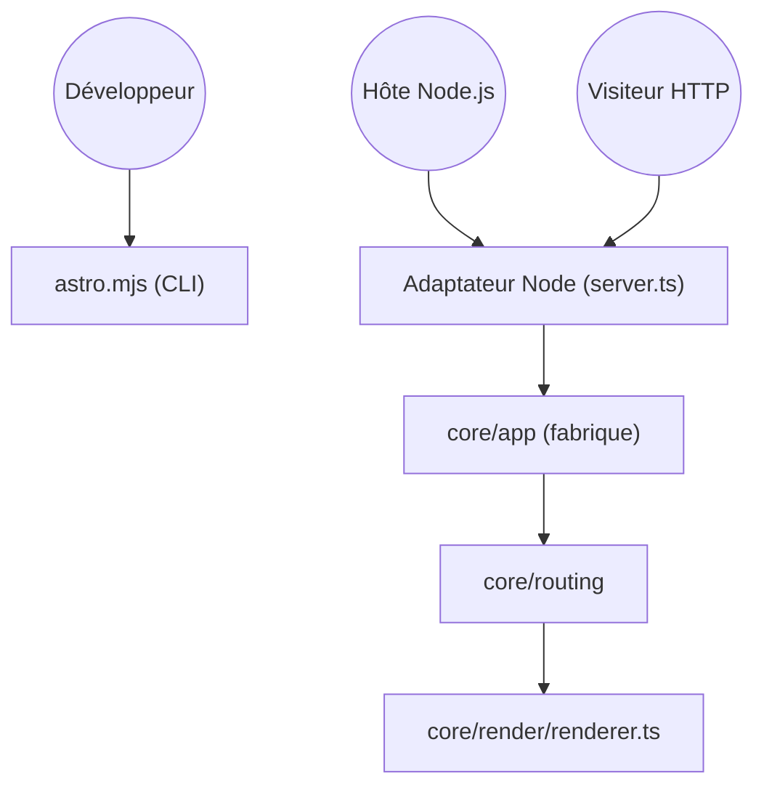

# withastro/astro

> Web framework for content sites that produces lightweight output, for front-end developers.

## The problem
Content sites ship too much JavaScript when they are built with application frameworks.

## What it actually does
Monorepo containing the `astro` CLI, the rendering and routing engine, content collections, server actions and integrations (React, Preact, Solid, Svelte, Vue, MDX, Node, Vercel, Netlify and Cloudflare adapters). Server rendering goes through an adapter: the Node host loads the adapter, which creates the application and answers requests.

## How it is wired


## Trying it
```bash
npm create astro@latest
npm install astro
```

## Cost and gotchas
Free. Requires Node; the choice of adapter depends on the host. License "to be verified" according to GitHub, while the README states MIT.

## What it is not
Not a data visualization tool nor an interactive application framework. The compiler and Starlight live in other repositories.

## Alternatives
- withastro/starlight: for documentation sites, maintained outside this repository.

## For you
Worth watching: useful for publishing documentation or a static project site, with no other data interest.
