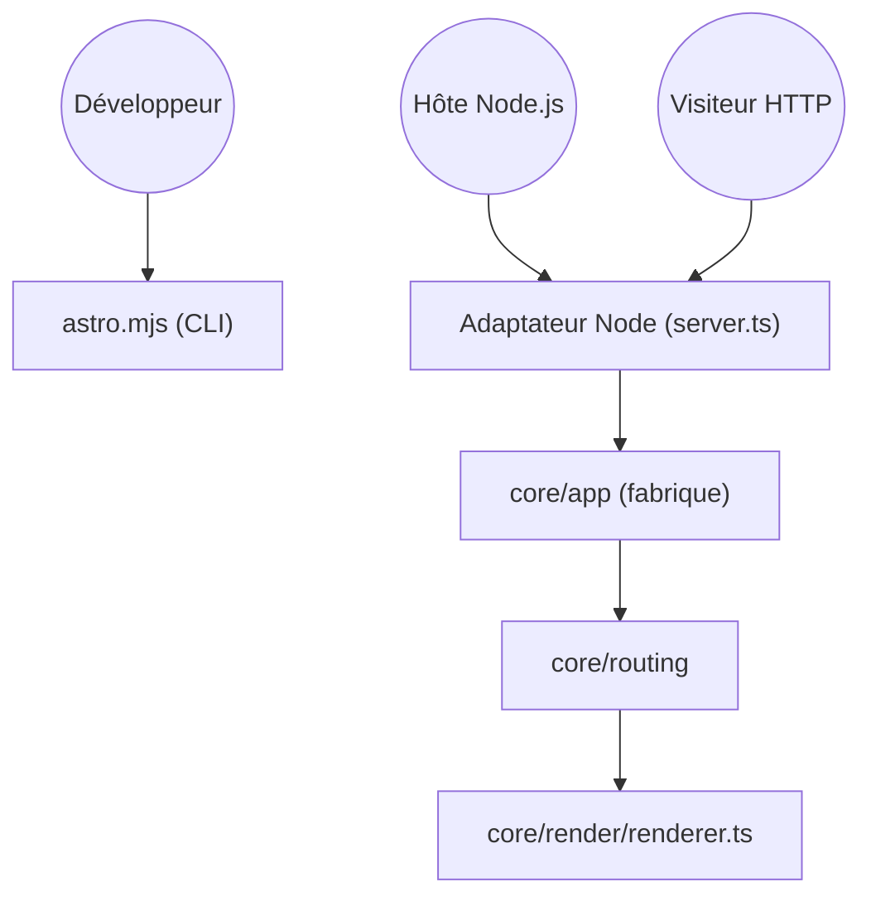

# withastro/astro

> Framework web pour sites de contenu, qui produit un rendu léger, pour développeurs front-end.

## Le problème
Les sites de contenu embarquent trop de JavaScript quand on les construit avec des frameworks d'applications.

## Ce que ça fait vraiment
Monorepo contenant le CLI `astro`, le moteur de rendu et de routage, les collections de contenu, les actions serveur et les intégrations (React, Preact, Solid, Svelte, Vue, MDX, adaptateurs Node, Vercel, Netlify, Cloudflare). Le rendu serveur passe par un adaptateur : l'hôte Node charge l'adaptateur, qui crée l'application et répond aux requêtes.

## Comment c'est branché


## Essayer
```bash
npm create astro@latest
npm install astro
```

## Coût et pièges
Gratuit. Il faut Node ; le choix de l'adaptateur dépend de l'hébergeur. Licence « à vérifier » selon GitHub, alors que le README annonce MIT.

## Ce que ce n'est pas
Pas un outil de visualisation de données ni un framework d'application interactive. Le compilateur et Starlight vivent dans d'autres dépôts.

## Alternatives
- withastro/starlight : pour des sites de documentation, maintenu hors de ce dépôt.

## Pour toi
À surveiller : sert à publier une documentation ou un site statique de projet, sans autre intérêt data.

