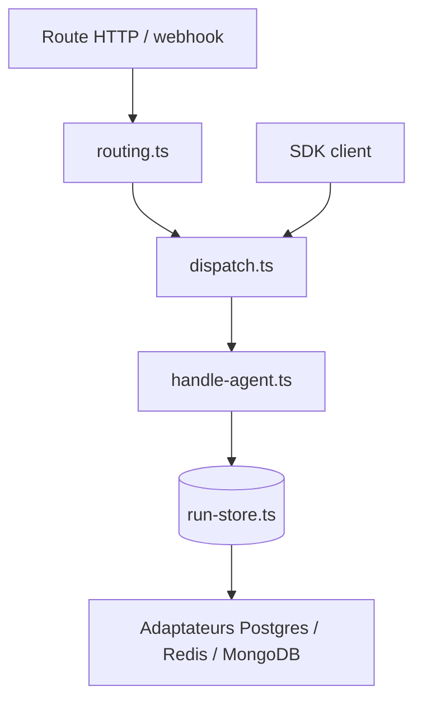

# withastro/flue

> TypeScript framework for building autonomous agents with sandbox, tools, skills and durable execution.

## The problem
Autonomous agents need sessions, tools, file access and a sandbox; without a harness, you rewrite everything.

## What it actually does
`@flue/runtime` defines an agent as a function that composes model, sandbox, skills and tools, with durable execution, event streaming and routing. Targets Node and Cloudflare Workers. Persistence adapters (Postgres, Redis, MongoDB, MySQL, LibSQL), channels (Slack, GitHub, Discord...), client SDK, React hooks, `flue` CLI. Observability via OpenTelemetry, Braintrust, Sentry.

## How it is wired

## Trying it
No installation command in the provided README, only a TypeScript agent example (`useModel`, `useSandbox`, `useSkill`, `useTool`) and the list of `@flue/*` packages.

## Cost and gotchas
The model called (e.g. Anthropic) is billed through your key. Hosted deployments (Cloudflare, Render, Daytona) have their own costs.

## What it is not
Not a raw LLM-call SDK nor a finished application: a harness to assemble.

## Alternatives
No alternative named in the README.

## For you
Watch: interesting for structuring durable agents in TypeScript, but young and with no installation guide in the README.
