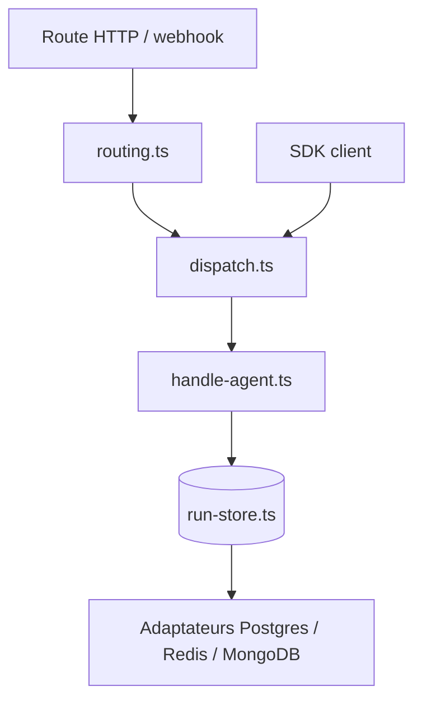

# withastro/flue

> Framework TypeScript pour construire des agents autonomes avec sandbox, outils, skills et exécution durable.

## Le problème
Les agents autonomes demandent sessions, outils, accès fichiers et bac à sable ; sans harnais, on réécrit tout.

## Ce que ça fait vraiment
`@flue/runtime` définit un agent comme une fonction qui compose modèle, sandbox, skills et outils, avec exécution durable, flux d'événements et routage. Cibles Node et Cloudflare Workers. Adaptateurs de persistance (Postgres, Redis, MongoDB, MySQL, LibSQL), canaux (Slack, GitHub, Discord…), SDK client, hooks React, CLI `flue`. Observabilité via OpenTelemetry, Braintrust, Sentry.

## Comment c'est branché

## Essayer
Aucune commande d'installation dans le README fourni, seulement un exemple d'agent TypeScript (`useModel`, `useSandbox`, `useSkill`, `useTool`) et la liste des paquets `@flue/*`.

## Coût et pièges
Le modèle appelé (ex. Anthropic) est facturé via ta clé. Les déploiements hébergés (Cloudflare, Render, Daytona) ont leurs propres coûts.

## Ce que ce n'est pas
Pas un SDK d'appel LLM brut ni une application finie : un harnais à assembler.

## Alternatives
Aucune alternative nommée dans le README.

## Pour toi
Surveiller : intéressant pour structurer des agents durables en TypeScript, mais jeune et sans guide d'installation dans le README.

