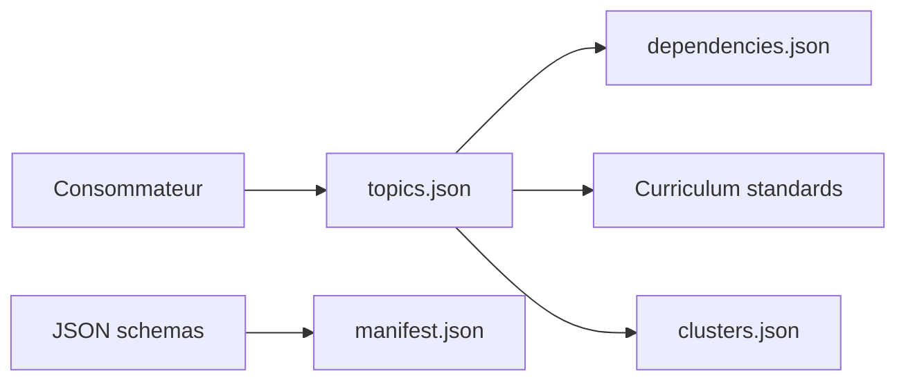

# withmarbleapp/os-taxonomy

> Open dataset of 1,590 elementary-school micro-concepts linked by prerequisites, for education and AI.

## The problem
School curricula are flat lists of standards or locked inside products, with no usable dependency graph.

## What it actually does
Provides in JSON 1,590 micro-concepts (description, evidence of mastery, type, subject, age range, centrality, NGSS, Common Core and British curriculum standards), 3,221 prerequisite links (strong or weak, with a reason), source standards and 183 domain summaries. A `validate.mjs` script checks the structure and the integrity of references; JSON schemas and a manifest with SHA-256 checksums accompany the data. No embeddings and no children's data.

## How it is wired


## Trying it
```bash
node scripts/validate.mjs
```

## Cost and gotchas
Free, but attribution is mandatory (ODbL for the database, CC BY-SA 4.0 for the content) plus the notices in PROVENANCE.md. The `assessmentPrompt` field contains a `{{name}}` to replace.

## What it is not
Not an application nor a model: the interactive viewer is not in the repository. Nor an official program of any State.

## Alternatives
No alternative named in the README.

## For you
Watch: a ready-made prerequisite graph for an adaptive tutoring or educational RAG project, provided you accept the share-alike clauses.
