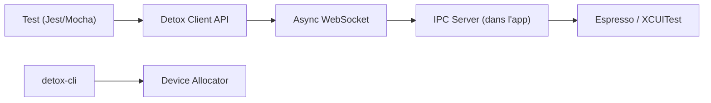

# wix/Detox

> "Gray box" end-to-end testing framework for React Native mobile applications.

## The problem
Mobile E2E tests are flaky: they fail non-deterministically.

## What it actually does
Your JavaScript tests drive the app in a simulator or on a device via `element()`, `expect()` and `device`. Detox monitors the app's asynchronous operations to wait until it is idle. Jest is built in. From the code: a Node client talks over WebSocket to a server inside the app, which delegates to Espresso (Android) or XCUITest (iOS).

## How it is wired

## Trying it
No command in the README; it points to the Getting Started Guide.

## Cost and gotchas
Free. Requires a simulator or emulator and the native build chain. The README flags a visibility edge case on Android. 210 open issues.

## What it is not
Not an API or load testing tool; it targets React Native applications.

## Alternatives
No alternative named in the README.

## For you
Watch: without a React Native mobile app to test, it has no use for a data/AI/MLOps profile.
