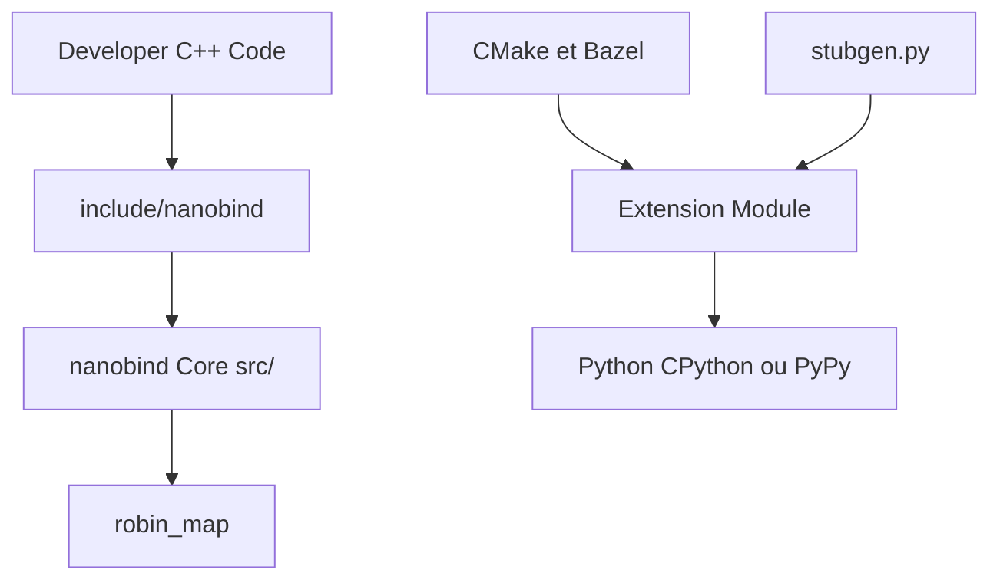

# wjakob/nanobind

> Lightweight C++17 library for exposing C++ to Python, a compact successor to pybind11.

## The problem
pybind11 and Boost.Python produce bindings that are slow to compile, heavy in binary size and costly at runtime.

## What it actually does
A header API almost identical to pybind11, with a small compiled core (`src/`) that relies on robin_map. It generates `.so` or `.pyd` extension modules, via CMake or Bazel, with `stubgen.py` for `.pyi` files. It handles multidimensional arrays (Eigen support) and can target the stable ABI of Python 3.12.

## How it is wired


## Trying it
```bash
# Aucune commande dans ce README : renvoie à la documentation HTML et PDF (tutoriel et référence).
```

## Cost and gotchas
Free, BSD-3-Clause. Requires a C++17 compiler, CMake or Bazel, and Python. The advertised gains (about 4x in compile time, 5x in size, 10x in overhead) come from the author's own benchmark.

## What it is not
Not a Python library: it is a tool for writing C++ extensions. Migrating from pybind11 still has to be done by hand.

## Alternatives
- pybind11: more widespread, but slower to compile and heavier.
- Boost.Python: the ancestor of the family, cited in the README.
- Cython: cited for the size and compile-time comparison.

## For you
Adopt it as soon as you need to expose C++ to Python: the README testimonials (JAX, MLX, XLA, IREE, PennyLane) make it a standard in numerical computing.
