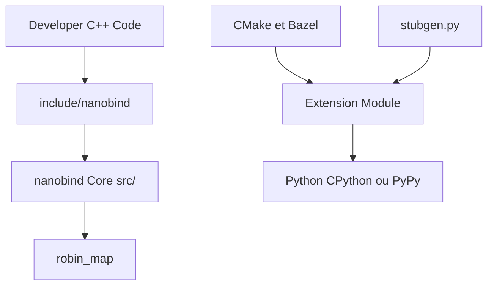

# wjakob/nanobind

> Bibliothèque C++17 légère pour exposer du C++ à Python, successeur compact de pybind11.

## Le problème
pybind11 et Boost.Python produisent des liaisons lentes à compiler, lourdes en binaire et coûteuses à l'exécution.

## Ce que ça fait vraiment
Une API d'en-têtes presque identique à pybind11, avec un petit cœur compilé (`src/`) qui s'appuie sur robin_map. Elle génère des modules d'extension `.so` ou `.pyd`, via CMake ou Bazel, avec `stubgen.py` pour les fichiers `.pyi`. Elle gère les tableaux multidimensionnels (support Eigen) et peut cibler l'ABI stable de Python 3.12.

## Comment c'est branché


## Essayer
```bash
# Aucune commande dans ce README : renvoie à la documentation HTML et PDF (tutoriel et référence).
```

## Coût et pièges
Gratuit, BSD-3-Clause. Il faut un compilateur C++17, CMake ou Bazel et Python. Les gains annoncés (environ 4 fois en compilation, 5 fois en taille, 10 fois en surcoût) viennent d'un benchmark de l'auteur.

## Ce que ce n'est pas
Pas une bibliothèque Python : c'est un outil pour écrire des extensions C++. La migration depuis pybind11 reste à faire à la main.

## Alternatives
- pybind11 : plus répandu, mais plus lent à compiler et plus lourd.
- Boost.Python : l'ancêtre de la famille, cité dans le README.
- Cython : cité pour la comparaison de taille et de compilation.

## Pour toi
À adopter dès que tu dois exposer du C++ à Python : les témoignages du README (JAX, MLX, XLA, IREE, PennyLane) en font un standard du calcul numérique.

