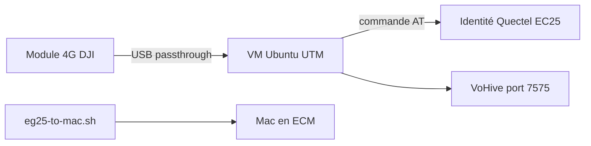

# wlzh/dji-4g-vohive-mac

> Tutorial for changing the USB identity of a DJI 4G module on a Mac and deploying VoHive on it.

## The problem
The DJI 4G module (actually a Quectel EG25-G) is not recognized by generic drivers, and the commands in the original tutorial only work on Linux.

## What it actually does
The repository describes, in Chinese, how to launch a Linux VM under UTM, pass the module through to it over USB, then rewrite its identifier `2ca3:4006` to `2C7C:0125` with an AT command. It then deploys VoHive (SMS, eSIM, proxy) from an included archive. Three scripts switch the module into a 4G card for the Mac.

## How it is wired
Simplified diagram based on the sheet, no diagram provided.


## Trying it
```bash
brew install --cask utm
echo 'AT+QCFG="usbcfg",0x2C7C,0x0125,1,1,1,1,1,0,0' | socat - /dev/ttyUSB2,crnl
echo 'AT+CFUN=1,1' | socat - /dev/ttyUSB2,crnl
```

## Cost and gotchas
You need the physical module, a Mac and UTM. VoHive starts with `admin/admin` by default. The prebuilt binaries come from a third party. 4G traffic on the Mac incurs SIM charges.

## What it is not
It is not VoHive itself (project iniwex5/vohive-release). Switching from Mac to VoHive is not automatic. No license is declared.

## Alternatives
No alternative named in the README, except other hypervisors (Parallels, VMware Fusion) for the VM.

## For you
Ignore: hardware tinkering unrelated to data or AI, with no license and third-party binaries.
