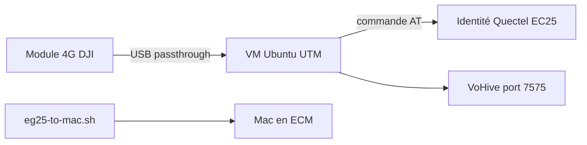

# wlzh/dji-4g-vohive-mac

> Tutoriel pour modifier l'identité USB d'un module 4G DJI sur Mac et y déployer VoHive.

## Le problème
Le module 4G DJI (en fait un Quectel EG25-G) n'est pas reconnu par les pilotes génériques, et les commandes du tutoriel d'origine ne marchent que sous Linux.

## Ce que ça fait vraiment
Le dépôt décrit, en chinois, comment lancer une VM Linux sous UTM, y faire passer le module en USB, puis réécrire son identifiant `2ca3:4006` en `2C7C:0125` avec une commande AT. Il déploie ensuite VoHive (SMS, eSIM, proxy) depuis une archive incluse. Trois scripts basculent le module en carte 4G pour le Mac.

## Comment c'est branché
Schéma simplifié d'après la fiche, sans diagramme fourni.


## Essayer
```bash
brew install --cask utm
echo 'AT+QCFG="usbcfg",0x2C7C,0x0125,1,1,1,1,1,0,0' | socat - /dev/ttyUSB2,crnl
echo 'AT+CFUN=1,1' | socat - /dev/ttyUSB2,crnl
```

## Coût et pièges
Il faut le module physique, un Mac et UTM. VoHive démarre avec `admin/admin` par défaut. Les binaires précompilés viennent d'un tiers. Le trafic 4G sur Mac génère des frais de SIM.

## Ce que ce n'est pas
Ce n'est pas VoHive lui-même (projet iniwex5/vohive-release). La bascule Mac vers VoHive n'est pas automatique. Aucune licence n'est déclarée.

## Alternatives
Aucune alternative nommée dans le README, sauf d'autres hyperviseurs (Parallels, VMware Fusion) pour la VM.

## Pour toi
À ignorer : du bricolage matériel sans lien avec la data ou l'IA, sans licence, avec des binaires tiers.

