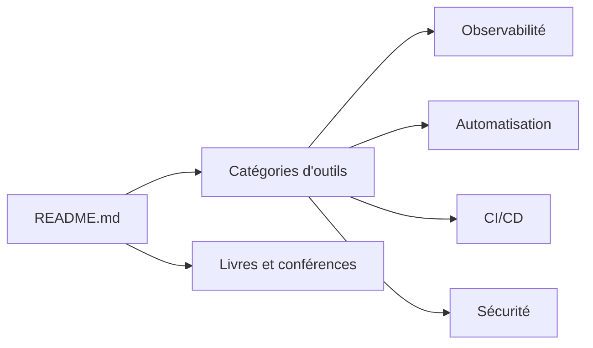

# wmariuss/awesome-devops

> Annotated list of DevOps and SRE platforms, tools and resources, organized by domain.

## The problem
The DevOps ecosystem is vast; spotting tools by category without starting from scratch takes time.

## What it actually does
A README of categorized links: public and open source clouds, systems, application platforms, internal developer platforms, registries, automation (Terraform, Ansible, Pulumi…), CI/CD, SCM, web servers, SSL, databases, observability, service mesh, chaos engineering, API gateways, messaging, secrets, security, VPN, books and conferences. Each entry has a one-line description.

## How it is wired


## Trying it
```bash
# Aucune commande documentée : liste à parcourir.
```

## Cost and gotchas
Free, CC0 license. Many entries are old or abandoned (Heka, Phabricator, CoreOS…) with no indication of status; some lines are promotional. 184 open issues.

## What it is not
Not a selection guide nor a comparison: entries are not evaluated. Little data/ML content.

## Alternatives
Not documented in the README: no alternative named.

## For you
A good entry point to find the name of a CI, observability or secrets tool in MLOps; always check the project's status before choosing one.
