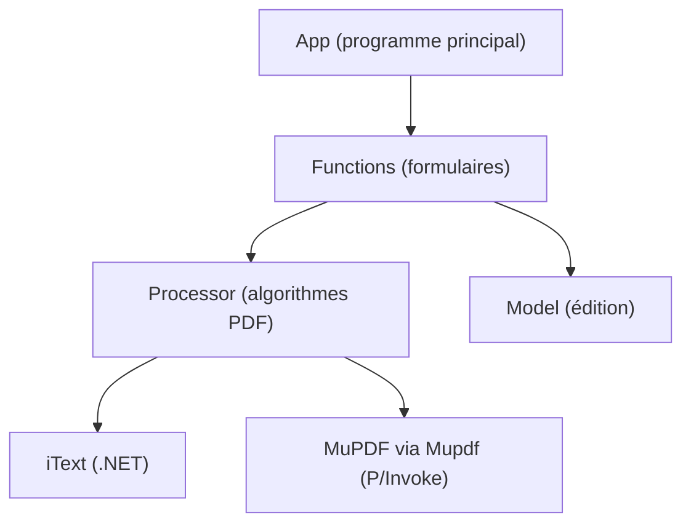

# wmjordan/PDFPatcher

> Windows application for editing PDFs: bookmarks, merging, splitting, image export, font replacement.

## The problem
Modifying a PDF's structure (bookmarks, pages, fonts, restrictions) often requires heavy or paid tools.

## What it actually does
Edits properties, page numbers and bookmarks, merges and splits PDFs, extracts images losslessly and converts pages to images. Replaces and embeds fonts, removes copy or print limits, and displays the structure as a tree or in XML. Text recognition goes through a Microsoft Office component (MODI). Built with iText and MuPDF.

## How it is wired
Simplified diagram based on the sheet, no diagram supplied.

## Trying it
No command documented: the README describes a graphical-interface program, to be launched on Windows.

## Cost and gotchas
Free. Windows 7 or later and .NET Framework 4.0 to 4.8; OCR requires Office 2003/2007. README in Chinese. The catalog indicates no recognized license, whereas the text announces AGPL plus a "good conscience" clause (donation of one thousandth of the revenue from derived software): read before any use of the code.

## What it is not
Not a reusable library in Python nor a cross-platform tool. The donation clause does not have the value of a standard license.

## Alternatives
No alternative named in the README (iText and MuPDF are components used).

## For you
Of little use for data/AI/MLOps (Windows, graphical interface, atypical license): ignore, except for occasional PDF tinkering.
