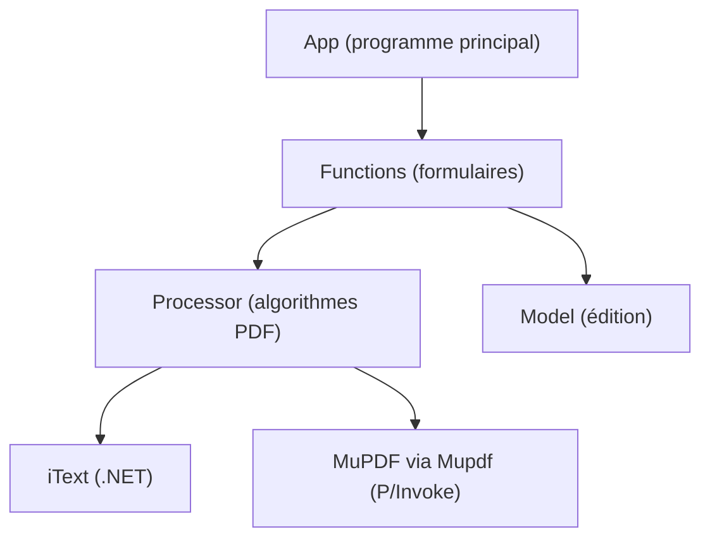

# wmjordan/PDFPatcher

> Application Windows de retouche de PDF : signets, fusion, découpe, export d'images, remplacement de polices.

## Le problème
Modifier la structure d'un PDF (signets, pages, polices, restrictions) demande souvent des outils lourds ou payants.

## Ce que ça fait vraiment
Édite propriétés, numéros de page et signets, fusionne et découpe des PDF, extrait les images sans perte et convertit des pages en images. Remplace et incorpore des polices, retire les limites de copie ou d'impression, et affiche la structure en arbre ou en XML. La reconnaissance de texte passe par un composant Microsoft Office (MODI). Construit avec iText et MuPDF.

## Comment c'est branché
Schéma simplifié d'après la fiche, sans diagramme fourni.

## Essayer
Aucune commande documentée : le README décrit un programme à interface graphique, à lancer sous Windows.

## Coût et pièges
Gratuit. Windows 7 ou plus et .NET Framework 4.0 à 4.8 ; l'OCR demande Office 2003/2007. README en chinois. Le catalogue indique aucune licence reconnue, alors que le texte annonce AGPL plus une clause de « bonne conscience » (don d'un millième des revenus de logiciels dérivés) : à lire avant tout usage du code.

## Ce que ce n'est pas
Ce n'est pas une bibliothèque réutilisable en Python ni un outil multiplateforme. La clause de don n'a pas valeur de licence standard.

## Alternatives
Aucune alternative nommée dans le README (iText et MuPDF sont des composants utilisés).

## Pour toi
Peu utile pour data/IA/MLOps (Windows, interface graphique, licence atypique) : à ignorer, sauf bricolage ponctuel de PDF.

