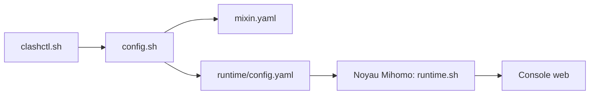

# wnlen/clash-for-linux

> Shell scripts to install and drive a Clash/Mihomo proxy on Linux (README in Chinese).

## The problem
Running Clash/Mihomo on a server, WSL or router without managing the core and subscriptions by hand.

## What it actually does
`install.sh` detects the architecture and downloads the core. The `clash` command manages multiple subscriptions, nodes, routing modes, Tun mode (root), the zashboard web console, boot, diagnostics (`doctor`) and `mixin.yaml` overlays. Offline mode via a resource bundle. OpenWrt in script mode.

## How it is wired


## Trying it
```bash
git clone --branch master --depth 1 https://ghfast.top/https://github.com/wnlen/clash-for-linux.git
cd clash-for-linux
bash install.sh
```

## Cost and gotchas
A proxy subscription from a third party is required. The repo fetches binaries through public mirrors. The console is exposed on 0.0.0.0:9090 by default, with a secret.

## What it is not
Not a proxy provider. The README states a purpose of studying Shell and leaves legal responsibility to the user.

## Alternatives
nelvko/clash-for-linux-install: cited as an inspiration, not a fork.

## For you
Ignore: off-topic network tool, with binary downloads through mirrors and usage subject to local rules.
