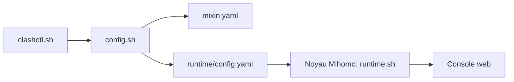

# wnlen/clash-for-linux

> Scripts shell pour installer et piloter un proxy Clash/Mihomo sur Linux (README en chinois).

## Le problème
Exploiter Clash/Mihomo sur serveur, WSL ou routeur sans gérer à la main le noyau et les abonnements.

## Ce que ça fait vraiment
`install.sh` détecte l'architecture et télécharge le noyau. La commande `clash` gère plusieurs abonnements, nœuds, modes de routage, mode Tun (root), console web zashboard, boot, diagnostic (`doctor`) et overlays `mixin.yaml`. Mode hors-ligne par paquet de ressources. OpenWrt en mode script.

## Comment c'est branché


## Essayer
```bash
git clone --branch master --depth 1 https://ghfast.top/https://github.com/wnlen/clash-for-linux.git
cd clash-for-linux
bash install.sh
```

## Coût et pièges
Il faut un abonnement proxy fourni par un tiers. Le dépôt récupère des binaires via des miroirs publics. Console exposée sur 0.0.0.0:9090 par défaut avec secret.

## Ce que ce n'est pas
Pas un fournisseur de proxy. Le README précise un but d'étude du Shell et renvoie la responsabilité légale à l'utilisateur.

## Alternatives
nelvko/clash-for-linux-install : cité comme inspiration, sans être un fork.

## Pour toi
Ignorer : outil réseau hors sujet, avec téléchargements de binaires par miroirs et usage soumis à des règles locales.

