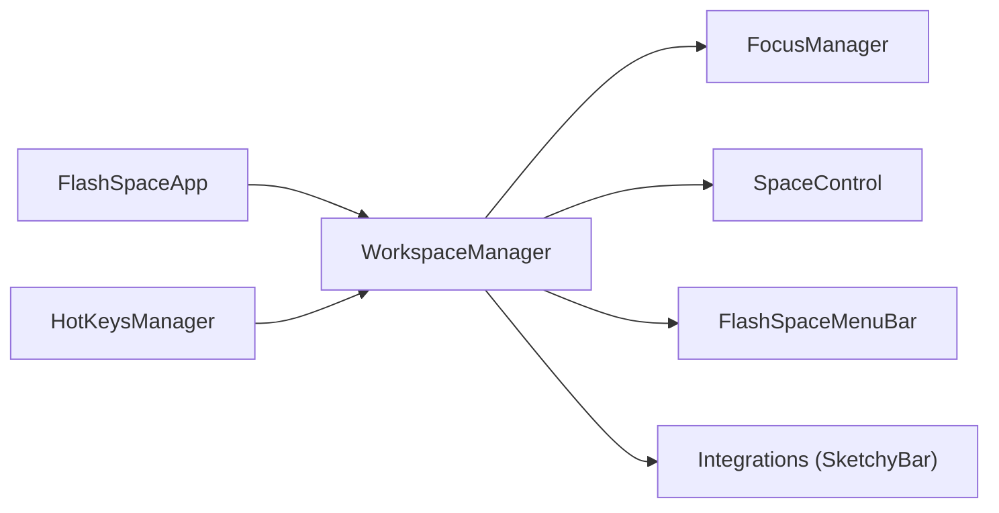

# wojciech-kulik/FlashSpace

> Virtual workspace manager for macOS that replaces native Spaces, for keyboard users.

## The problem
macOS Spaces impose animations and slow switching between groups of apps.

## What it actually does
You define workspaces and assign apps and a display to them. On switching, the assigned apps are shown and the other apps on that display are hidden. It adds shortcuts, an `Option + Tab` switcher, a grid view, profiles and a CLI. It does not manage unassigned windows.

## How it is wired


## Trying it
```bash
brew install flashspace
flashspace --help
```
The CLI is installed from the app's settings. Prerequisites: macOS 14+ and "Displays have separate Spaces" enabled.

## Cost and gotchas
Free. Requires the Accessibility permission. Known macOS bug: apps on the wrong display after sleep.

## What it is not
Not a tiling window manager. It does not manage windows of unassigned apps, by design.

## Alternatives
No alternative named, apart from mentions of Raycast, Magnet and SKHD as complements.

## For you
Ignore on the data/AI side: it is a macOS desktop convenience, unrelated to your work.
