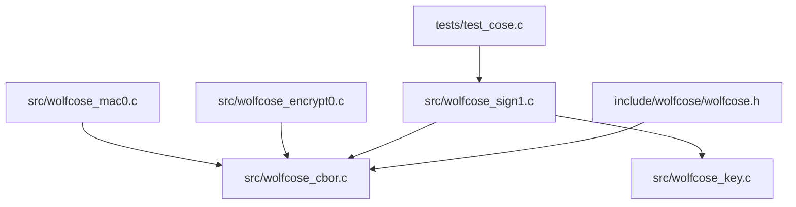

# wolfSSL/wolfCOSE

> Lightweight C library for CBOR and COSE, built on wolfSSL, for embedded systems.

## The problem
Signing, encrypting and authenticating COSE messages on a microcontroller requires a compact cryptographic stack with no dynamic allocation.

## What it actually does
Implements the six COSE message types of RFC 9052, the countersignatures of RFC 9338, the post-quantum signatures ML-DSA and HSS/LMS, and PSA/EAT tokens. No dynamic allocation; 100% line coverage required. Interoperability tests exist with Go, Python and Rust.

## How it is wired


## Trying it
```bash
cd wolfssl
./autogen.sh
./configure --enable-ecc --enable-aesgcm --enable-sha384 --enable-sha512 --enable-keygen
make && sudo make install
make
make test
```

## Cost and gotchas
wolfSSL 5.8.0 minimum, to be built first. GPL-3.0 license: use in a closed-source product requires checking the terms with wolfSSL.

## What it is not
Not a general-purpose encryption library: a message format on top of wolfCrypt.

## Alternatives
- No alternative named in the README (a "wolfCOSE vs. The Field" comparison is mentioned).

## For you
Ignore: embedded cryptography in C, outside the data / AI / MLOps scope.
