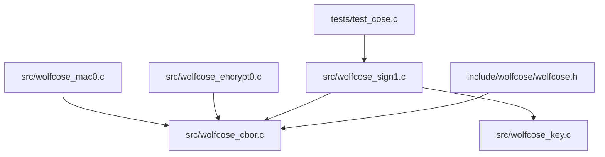

# wolfSSL/wolfCOSE

> Bibliothèque C légère pour CBOR et COSE, bâtie sur wolfSSL, pour les systèmes embarqués.

## Le problème
Signer, chiffrer et authentifier des messages COSE sur microcontrôleur demande une pile cryptographique compacte et sans allocation dynamique.

## Ce que ça fait vraiment
Implémente les six types de messages COSE de la RFC 9052, les contre-signatures de la RFC 9338, la signature post-quantique ML-DSA et HSS/LMS, et les jetons PSA/EAT. Aucune allocation dynamique ; couverture de lignes de 100 % exigée. Des tests d'interopérabilité existent avec Go, Python et Rust.

## Comment c'est branché


## Essayer
```bash
cd wolfssl
./autogen.sh
./configure --enable-ecc --enable-aesgcm --enable-sha384 --enable-sha512 --enable-keygen
make && sudo make install
make
make test
```

## Coût et pièges
wolfSSL 5.8.0 minimum, à compiler avant. Licence GPL-3.0 : un usage dans un produit fermé demande de vérifier les conditions auprès de wolfSSL.

## Ce que ce n'est pas
Pas une bibliothèque de chiffrement générale : un format de messages sur wolfCrypt.

## Alternatives
- Aucune alternative nommée dans le README (une comparaison « wolfCOSE vs. The Field » est mentionnée).

## Pour toi
Ignorer : de la cryptographie embarquée en C, hors du périmètre data / IA / MLOps.

