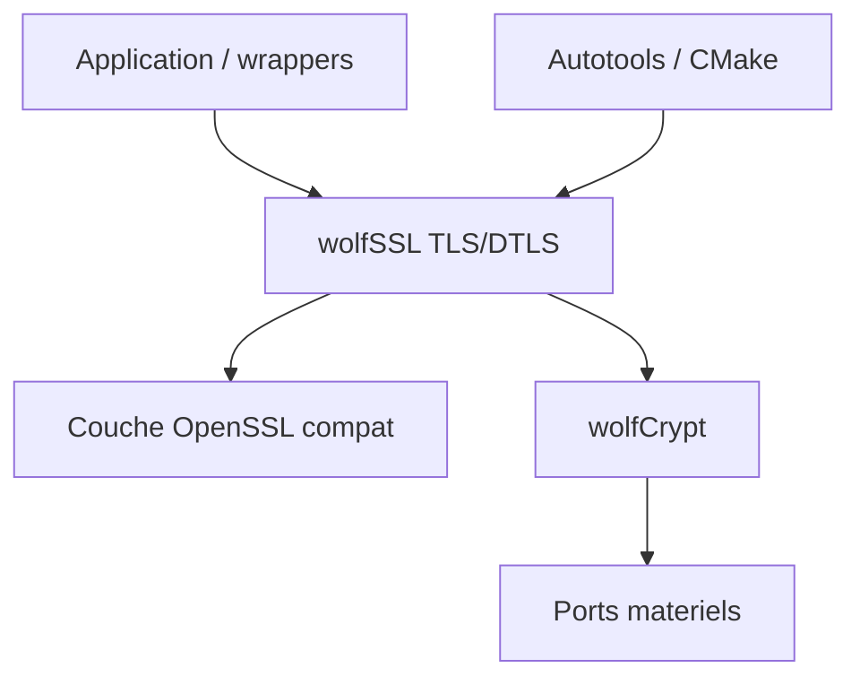

# wolfSSL/wolfssl

> SSL/TLS library in C for embedded and constrained systems, with an OpenSSL compatibility layer.

## The problem
OpenSSL is too large for embedded or real-time targets with a few tens of KB.

## What it actually does
Implements TLS up to 1.3 and DTLS 1.3 on top of wolfCrypt (FIPS 140-2/140-3 validated modules according to the README). Announced footprint of 20 to 100 KB, modern ciphers, post-quantum algorithms (ML-KEM, ML-DSA, SLH-DSA, Falcon, FrodoKEM), many hardware ports, SBOM generation (SPDX, CycloneDX) for the Cyber Resilience Act. Version 5.9.4 fixes several high-severity CVEs (trusted peer verification, multiple OCSP, RPK).

## How it is wired


## Trying it
```bash
make sbom
make advisory
python3 scripts/gen-sbom …
```

## Cost and gotchas
Free under GPL-3.0; use in a closed product requires a commercial license (not detailed in this README). If you use the `--enable-all` options, check the CVEs of 5.9.2 and earlier.

## What it is not
Not a turnkey binary: you compile it and integrate it. Behavior differs from OpenSSL (server verification by default).

## Alternatives
No alternative named in the README, apart from OpenSSL (point of comparison).

## For you
Ignore: embedded cryptographic layer; relevant only for AI on microcontrollers.
