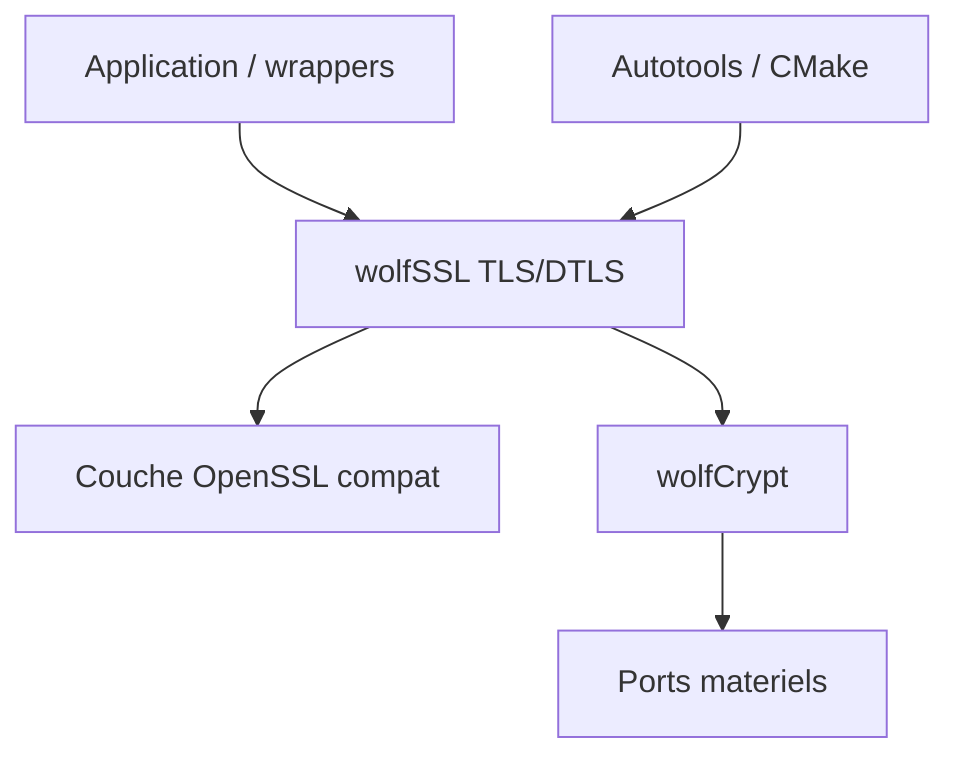

# wolfSSL/wolfssl

> Bibliothèque SSL/TLS en C pour systèmes embarqués et contraints, avec couche de compatibilité OpenSSL.

## Le problème
OpenSSL est trop volumineux pour des cibles embarquées ou temps réel à quelques dizaines de ko.

## Ce que ça fait vraiment
Implémente TLS jusqu'à 1.3 et DTLS 1.3 au-dessus de wolfCrypt (modules validés FIPS 140-2/140-3 d'après le README). Empreinte annoncée de 20 à 100 ko, chiffrements modernes, algorithmes post-quantiques (ML-KEM, ML-DSA, SLH-DSA, Falcon, FrodoKEM), nombreux ports matériels, génération de SBOM (SPDX, CycloneDX) pour le Cyber Resilience Act. La version 5.9.4 corrige plusieurs CVE de gravité haute (vérification de pairs de confiance, OCSP multiple, RPK).

## Comment c'est branché


## Essayer
```bash
make sbom
make advisory
python3 scripts/gen-sbom …
```

## Coût et pièges
Gratuit sous GPL-3.0 ; l'usage dans un produit fermé suppose une licence commerciale (non détaillée dans ce README). Si tu utilises les options `--enable-all`, vérifie les CVE de la 5.9.2 et antérieures.

## Ce que ce n'est pas
Pas un binaire clé en main : on la compile et on l'intègre. Le comportement diffère d'OpenSSL (vérification du serveur par défaut).

## Alternatives
Aucune alternative nommée dans le README, hormis OpenSSL (point de comparaison).

## Pour toi
À ignorer : couche cryptographique embarquée ; pertinent seulement pour de l'IA embarquée sur microcontrôleurs.

