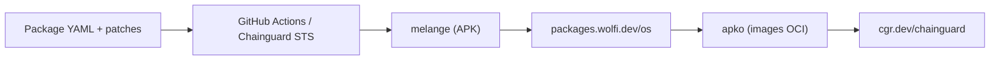

# wolfi-dev/os

> Repository of package recipes for Wolfi, a minimal Linux distribution for containers, sponsored by Chainguard.

## The problem
Base container images ship too many packages, hence too many CVEs. A minimal base that is updated quickly is needed.

## What it actually does
Contains the YAML package manifests and patches. CI: GitHub Actions and Chainguard workflows (CVE scan, SBOM, licenses). melange builds the APK packages, apko builds the OCI images. The repository is a read-only public clone synchronized from internal Chainguard repositories: PRs are not merged there.

## How it is wired


## Trying it
```bash
docker run -it cgr.dev/chainguard/wolfi-base
```

## Cost and gotchas
Free for the base image. Mixing packages with other distributions is not supported, even though Alpine also uses apk. The repository license is not identified by GitHub.

## What it is not
Not a desktop distribution. Not a repository where you can contribute directly.

## Alternatives
- Alpine: same apk package manager, but incompatible packages (cited by the README).
- Ready-to-use chainguard images.

## For you
Watch: a minimal image base reduces the CVE surface of your ML serving containers, but you mostly consume the images, not this repository.
