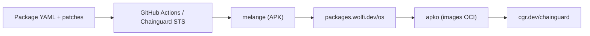

# wolfi-dev/os

> Dépôt des recettes de paquets de Wolfi, distribution Linux minimale pour conteneurs, sponsorisée par Chainguard.

## Le problème
Les images de conteneurs de base embarquent trop de paquets, donc de CVE. Il faut une base minimale et mise à jour vite.

## Ce que ça fait vraiment
Contient les manifestes YAML de paquets et patches. CI : GitHub Actions et workflows Chainguard (scan CVE, SBOM, licences). melange construit les paquets APK, apko les images OCI. Le dépôt est un clone public en lecture seule synchronisé depuis des dépôts internes Chainguard : les PR ne s'y fusionnent pas.

## Comment c'est branché


## Essayer
```bash
docker run -it cgr.dev/chainguard/wolfi-base
```

## Coût et pièges
Gratuit pour l'image de base. Mélanger les paquets avec d'autres distributions n'est pas supporté, même si Alpine utilise aussi apk. Licence du dépôt non identifiée par GitHub.

## Ce que ce n'est pas
Pas une distribution de bureau. Pas un dépôt où contribuer directement.

## Alternatives
- Alpine : même gestionnaire apk, mais paquets incompatibles (cité par le README).
- Les images chainguard prêtes à l'emploi.

## Pour toi
À surveiller : une base d'images minimale réduit la surface de CVE de tes conteneurs de serving ML, mais tu consommes surtout les images, pas ce dépôt.

