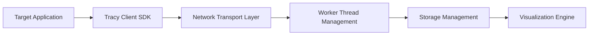

# wolfpld/tracy

> Real-time, nanosecond-resolution profiler for games and applications: CPU, GPU, memory and locks.

## The problem
Finding where an application's time goes (CPU, GPU, allocations, locks) without slowing down what is being measured.

## What it actually does
A client library integrates into the code (C, C++, Lua, Python, Fortran; third-party bindings elsewhere), sends events over a compressed network link to the profiling application, which stores them and displays them as a timeline, memory views and statistics. GPU: OpenGL, Vulkan, Direct3D 11/12, Metal, OpenCL, CUDA, WebGPU. Hybrid frames and sampling, per-frame screenshots.

## How it is wired

## Trying it
No command documented in the README; the documentation (tracy.pdf) and Windows x64 binaries are in the releases.

## Cost and gotchas
Free. You have to instrument the code; the provided binaries are Windows x64, elsewhere you have to compile. A license is present but not identified by GitHub.

## What it is not
Not an ML model profiler or a production monitoring tool: it targets native application development.

## Alternatives
No alternative named in the README.

## For you
Worth watching: useful if you write native code or GPU/CUDA kernels to optimize; outside that case, no immediate interest.
