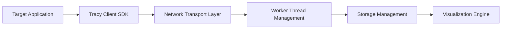

# wolfpld/tracy

> Profileur temps réel à résolution nanoseconde pour jeux et applications, CPU, GPU, mémoire et verrous.

## Le problème
Trouver où part le temps d'une application (CPU, GPU, allocations, verrous) sans ralentir ce qu'on mesure.

## Ce que ça fait vraiment
Une bibliothèque cliente s'intègre au code (C, C++, Lua, Python, Fortran ; liaisons tierces ailleurs), envoie les événements par réseau compressé à l'application de profilage, qui les stocke et les affiche en timeline, vues mémoire et statistiques. GPU : OpenGL, Vulkan, Direct3D 11/12, Metal, OpenCL, CUDA, WebGPU. Frames et sampling hybrides, captures d'écran par frame.

## Comment c'est branché

## Essayer
Aucune commande documentée dans le README ; la documentation (tracy.pdf) et des binaires Windows x64 sont dans les releases.

## Coût et pièges
Gratuit. Il faut instrumenter le code ; les binaires fournis sont Windows x64, ailleurs il faut compiler. Licence présente mais non identifiée par GitHub.

## Ce que ce n'est pas
Pas un profileur de modèles ML ni un outil de monitoring en production : il vise le développement d'applications natives.

## Alternatives
Aucune alternative nommée dans le README.

## Pour toi
À surveiller : utile si tu écris du code natif ou des noyaux GPU/CUDA à optimiser ; hors de ce cas, sans intérêt immédiat.

