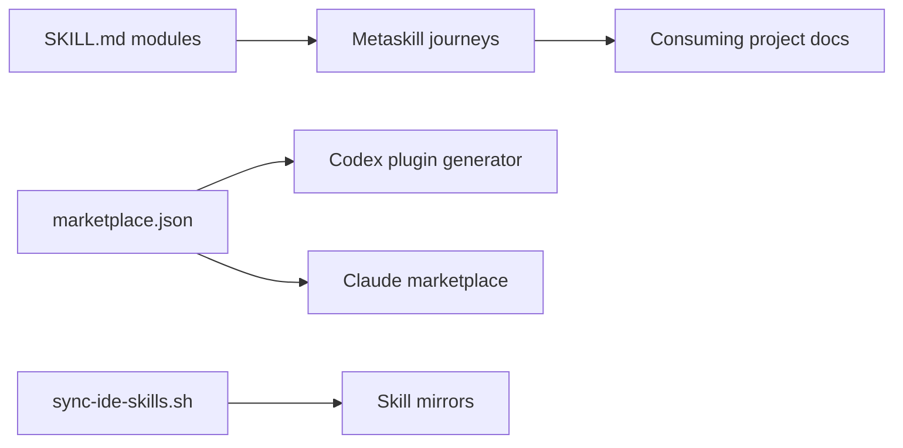

# wondelai/skills

> Collection of 65 agent skills inspired by business, UX and code books, with guided journeys.

## The problem
A coding agent rarely applies a precise methodological framework (JTBD, Clean Code, DDIA…) without structured instructions.

## What it actually does
Markdown repository: 51 `SKILL.md` skills drawn from books, plus 14 metaskills that chain these skills by phases and keep state in the project's `docs/` folder. Packaged for Claude, Codex, Cursor and others, via plugin marketplace or `npx skills`. No runtime. The README says the skills are written without copying the books.

## How it is wired


## Trying it
```bash
/plugin marketplace add wondelai/skills
/plugin install code-craftsmanship@wondelai-skills
npx skills add wondelai/skills/clean-code --global
```

## Cost and gotchas
Free. Only your agent's token cost is added. The content is mostly non-technical (marketing, sales, management).

## What it is not
Not the content of the books. The metaskills are workflows designed by Wondel.ai, and the publisher sells consulting.

## Alternatives
No alternative named in the README.

## For you
Ignore: most of it is business and marketing; only a few architecture or code skills may be useful to a data/MLOps profile.
