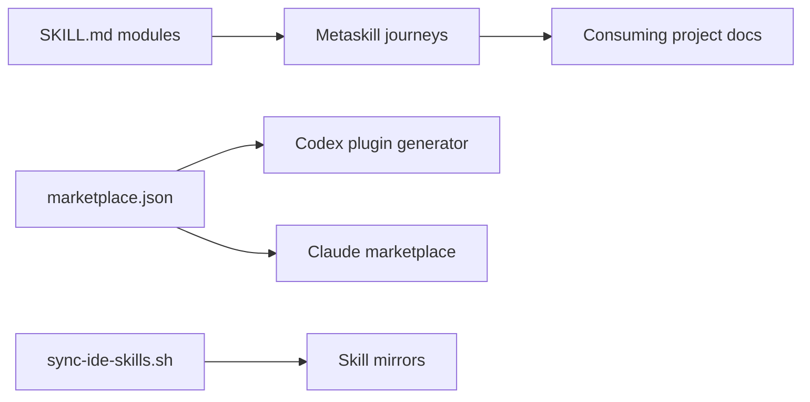

# wondelai/skills

> Collection de 65 skills d'agents inspirés de livres business, UX et code, avec parcours guidés.

## Le problème
Un agent de code applique rarement un cadre méthodologique précis (JTBD, Clean Code, DDIA…) sans instructions structurées.

## Ce que ça fait vraiment
Dépôt Markdown : 51 skills `SKILL.md` tirés de livres, plus 14 metaskills qui enchaînent ces skills par phases et gardent l'état dans le dossier `docs/` du projet. Packagés pour Claude, Codex, Cursor et autres, via marketplace de plugins ou `npx skills`. Aucun runtime. Le README dit les skills écrits sans copier les livres.

## Comment c'est branché


## Essayer
```bash
/plugin marketplace add wondelai/skills
/plugin install code-craftsmanship@wondelai-skills
npx skills add wondelai/skills/clean-code --global
```

## Coût et pièges
Gratuit. Seul le coût en tokens de ton agent s'ajoute. Le contenu est surtout non technique (marketing, vente, management).

## Ce que ce n'est pas
Pas le contenu des livres. Les metaskills sont des workflows conçus par Wondel.ai, et l'éditeur vend du conseil.

## Alternatives
Aucune alternative nommée dans le README.

## Pour toi
Ignorer : l'essentiel est du business et du marketing ; seuls quelques skills d'architecture ou de code peuvent servir à un profil data/MLOps.

