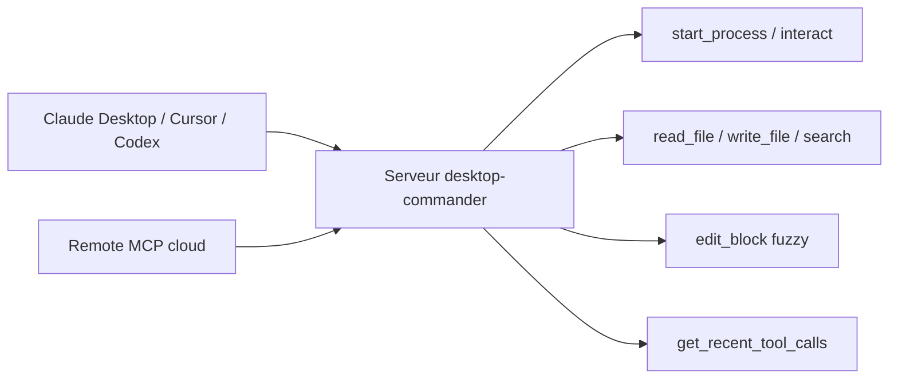

# wonderwhy-er/DesktopCommanderMCP

> MCP server giving an assistant access to the terminal, files and processes.

## The problem
A chat assistant can neither run a script, nor edit a file in place, nor keep an SSH session open; the AI editors that do charge per API token.

## What it actually does
Exposes MCP tools in four families: configuration (`get_config`, `set_config_value`), terminal (`start_process`, `interact_with_process`, `read_process_output`, session and process management), file system (paginated reading including Excel and PDF, writing, streaming search via ripgrep, metadata) and editing (`edit_block`, surgical replacements with fuzzy-search fallback and character-level diff). Runs code in memory (Python, Node, R) without a temporary file. Local history of tool calls, bounded by rotation.

## How it is wired


## Trying it
```bash
npx @wonderwhy-er/desktop-commander@latest setup
npx @wonderwhy-er/desktop-commander@latest remove
claude mcp add --scope user desktop-commander -- npx -y @wonderwhy-er/desktop-commander@latest
docker run -i --rm mcp/desktop-commander:latest
```

## Cost and gotchas
Free on the server side: it uses the host client's subscription instead of API tokens. Node.js required (except with Docker). A `telemetryEnabled` setting appears in the configuration. Remote MCP mode routes commands through a cloud service before local execution.

## What it is not
**Not a sandbox**: the README says so explicitly and points to SECURITY.md. The safeguards are limited to a list of blocked commands and symlink prevention; `allowedDirectories` does not constrain terminal commands. Real isolation comes from Docker. README truncated at the source.

## Alternatives
- **Desktop Commander App**: app version in beta, by the same author, to be downloaded separately.

## For you
Powerful but dangerous outside Docker: confine it to a disposable machine.
