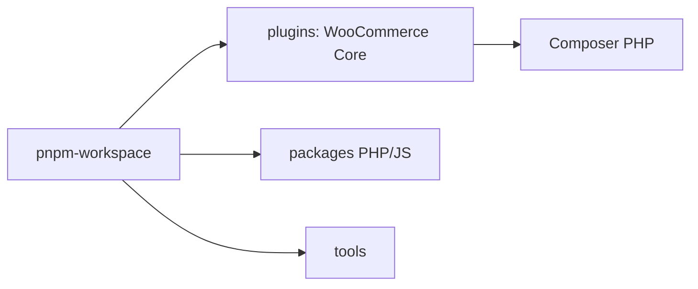

# woocommerce/woocommerce

> Monorepo of the WooCommerce e-commerce plugin, its packages and tools, for WordPress developers.

## The problem
Building and extending an online shop on WordPress.

## What it actually does
It groups the core plugin (`plugins/`), PHP and JS packages (some prefixed `internal-`) and tools. It is built with PNPM, Composer, PHP 7.4+; the Node version is pinned by `pnpm-workspace.yaml`.

## How it is wired


## Trying it
```bash
pnpm install --frozen-lockfile
pnpm build
```

## Cost and gotchas
PNPM, PHP 7.4+, Composer; POSIX required (WSL on Windows). Vulnerabilities are to be reported via HackerOne.

## What it is not
Not a ready-to-use site: it is the development repository. GPL-2.0 license: copyleft.

## Alternatives
No alternative named.

## For you
Ignore: a PHP e-commerce platform unrelated to your data/AI work.
