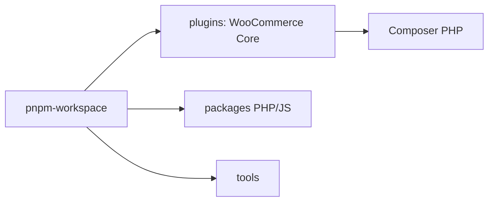

# woocommerce/woocommerce

> Monorepo du plugin e-commerce WooCommerce, de ses paquets et outils, pour développeurs WordPress.

## Le problème
Construire et étendre une boutique en ligne sur WordPress.

## Ce que ça fait vraiment
Regroupe le plugin cœur (`plugins/`), des paquets PHP et JS (certains préfixés `internal-`) et des outils. Se construit avec PNPM, Composer, PHP 7.4+ ; la version de Node est épinglée par `pnpm-workspace.yaml`.

## Comment c'est branché


## Essayer
```bash
pnpm install --frozen-lockfile
pnpm build
```

## Coût et pièges
PNPM, PHP 7.4+, Composer ; POSIX requis (WSL sous Windows). Failles à signaler via HackerOne.

## Ce que ce n'est pas
Pas un site prêt à l'emploi : c'est le dépôt de développement. Licence GPL-2.0 : copyleft.

## Alternatives
Aucune alternative nommée.

## Pour toi
Ignorer : plateforme e-commerce PHP sans rapport avec ton métier data/IA.

