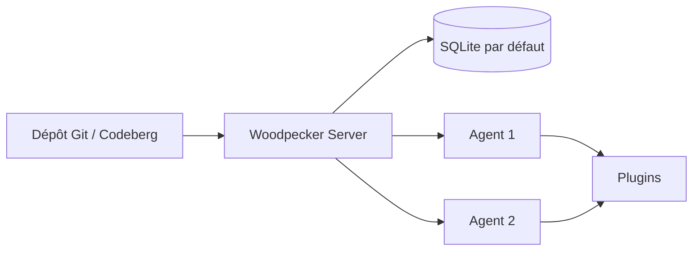

# woodpecker-ci/woodpecker

> Lightweight CI/CD engine extensible through plugins, used in production by Codeberg.

## The problem
Self-hosted CI engines often require a database, several gigabytes of
RAM and a team to maintain them, which is disproportionate for a small Git hosting.

## What it actually does
Server plus agents, SQLite by default, so no external service to provision to get started.
Advertised idle footprint: about 100 MB of RAM on the server side and 30 MB on the agent side.
Extensibility goes through plugins, listed on a dedicated site that mixes plugins from the
core team and community contributions. Translations are managed on a self-hosted Weblate instance.

## How it is wired


## Trying it
```bash
# Aucune commande documentée dans le README : il renvoie aux « Installation Instructions »
# et au site de documentation du projet.
```

## Cost and gotchas
Free and self-hosted. The README says nothing about the license, nor about SQLite's limits at
scale, nor about the agents' security model — yet these are the two points that decide
adoption. The installation itself is not described here.

## What it is not
It is not a hosted service: there is no SaaS offering. It is not a direct replacement for
GitHub Actions: the plugins are not the same, and the library is smaller.

## Alternatives
No alternative named in the README.

## For you
Good candidate for a personal or lightweight team CI; little benefit if you are already on GitHub Actions.
