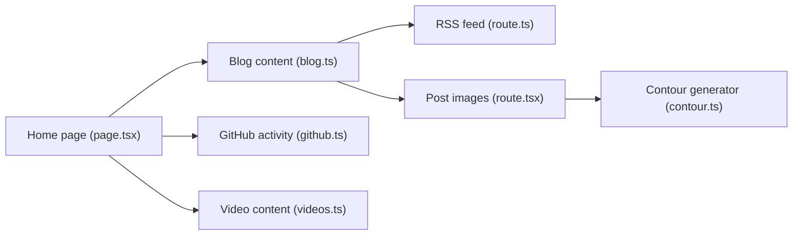

# woosal1337/blog

> Code of a personal Next.js blog and portfolio with a dark theme, published on Vercel.

## The problem
A personal site needs a theme, a post system and cover visuals without producing images by hand.

## What it actually does
Next.js 14 site (App Router) with MDX posts, a side table of contents, banners generated from the title by a contour-line mark (`lib/contour.ts`), a Tailwind dark theme, design components and ASCII blocks. Sections include writing, videos, projects, gallery and reading shelf; the home page aggregates posts, episodes and GitHub activity. RSS feed and post images generated by routes. No environment variable required.

## How it is wired


## Trying it
```bash
bun install
bun dev
bun run build
bun run check
```

## Cost and gotchas
Free; Node 20+ and Bun required. The license is not identified by GitHub, so reuse of the code is uncertain.

## What it is not
Not a ready-to-fork template: it is one person's site, with their content and visual identity.

## Alternatives
No alternative named in the README (it cites soft-club-ui and LineNav as component sources).

## For you
Ignore: a personal blog with no general reach; only the deterministic cover generator might inspire.
