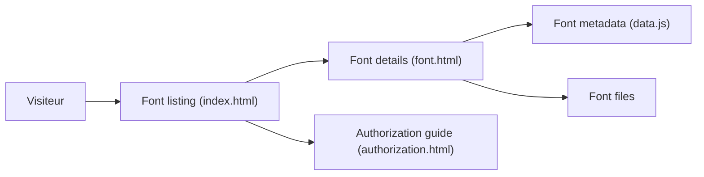

# wordshub/free-font

> Catalog of Chinese fonts that are free or open for commercial use, with their license terms.

## The problem
Chinese font licenses are varied and obscure; small organizations do not know which ones are actually usable at no cost.

## What it actually does
Lists dozens of fonts (Fangzheng, Source Han, ZCOOL, Wenquanyi, Wang Han-Zong, OPPO Sans, Alibaba PuHuiTi, Japanese fonts...), sorted by style, with a description and the origin of the authorization. A section explains the difference between "free for commercial use" and "open" (GPL, SIL OFL, IPA) and flags the risky fonts (the GPL of Wenquanyi, the dispute over the Wang Han-Zong fonts). The static site relies on `data.js`, `index.html` and `font.html`. The "English" and "Numbers" sections are empty.

## How it is wired

## Trying it
No documented command: you browse the catalog.

## Cost and gotchas
Free, but the repository has no declared license and the last push dates from February 2025; publishers' terms may have changed (the README says so itself).

## What it is not
Not legal advice: the final disclaimer says so. Nor a guaranteed host of the font files.

## Alternatives
No alternative named in the README (it cites external guides).

## For you
Ignore: useful only for a design project in Chinese; unrelated to your work.
