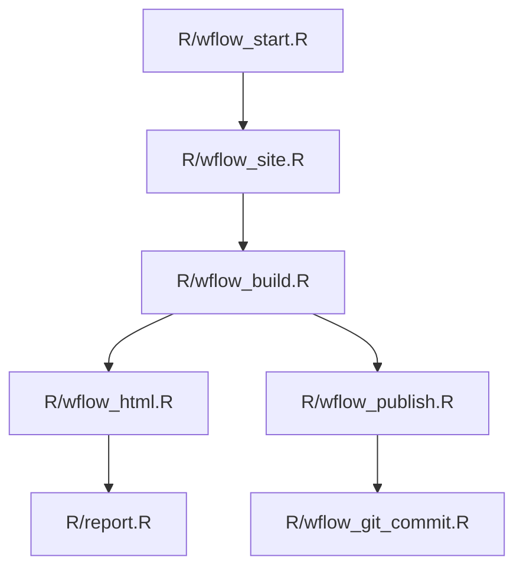

# workflowr/workflowr

> R package that organizes reproducible analyses and publishes a website versioned with git.

## The problem
Research analyses get scattered and you no longer know which code produced which result.

## What it actually does
Provides a project template, builds a site from R Markdown, runs each analysis in an isolated R session with a fixed seed, records the session and links each result to the code version. `wflow_publish` versions through git2r; hosting is possible on GitHub or GitLab Pages.

## How it is wired
Diagram based on the code's diagram.


## Trying it
```r
install.packages("workflowr")
library("workflowr")
wflow_start("myproject")
wflow_build()
wflow_publish("analysis/*", "Start my new project")
```

## Cost and gotchas
Free. Requires R, preferably RStudio, and git; a GitHub or GitLab account to publish. The README says MIT but GitHub does not identify it: to be checked.

## What it is not
Not a Python tool nor a pipeline orchestrator. It is an R Markdown reporting framework.

## Alternatives
No alternative named in the README (an r-project-workflows page is mentioned).

## For you
Worth watching if you do analysis in R: good reproducibility discipline, of no interest in Python.
