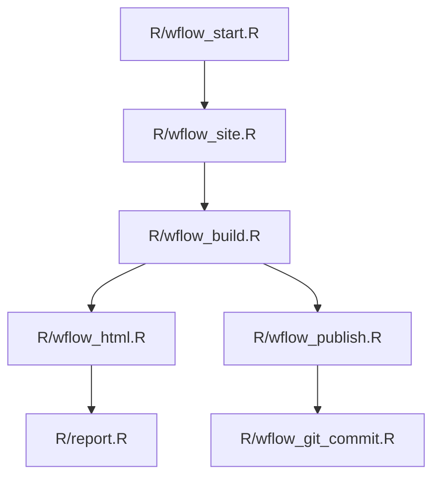

# workflowr/workflowr

> Package R qui organise des analyses reproductibles et publie un site web versionné avec git.

## Le problème
Les analyses de recherche s'éparpillent et on ne sait plus quel code a produit quel résultat.

## Ce que ça fait vraiment
Fournit un gabarit de projet, construit un site à partir de R Markdown, exécute chaque analyse dans une session R isolée avec graine fixée, enregistre la session et lie chaque résultat à la version de code. `wflow_publish` versionne via git2r ; hébergement possible sur GitHub ou GitLab Pages.

## Comment c'est branché
Schéma d'après le diagramme du code.


## Essayer
```r
install.packages("workflowr")
library("workflowr")
wflow_start("myproject")
wflow_build()
wflow_publish("analysis/*", "Start my new project")
```

## Coût et pièges
Gratuit. Il faut R, de préférence RStudio, et git ; un compte GitHub ou GitLab pour publier. Le README dit MIT mais GitHub ne l'identifie pas : à vérifier.

## Ce que ce n'est pas
Pas un outil Python ni un orchestrateur de pipelines. C'est un cadre de rapports R Markdown.

## Alternatives
Aucune alternative nommée dans le README (une page r-project-workflows est citée).

## Pour toi
À surveiller si tu fais de l'analyse en R : bonne discipline de reproductibilité, sans intérêt en Python.

