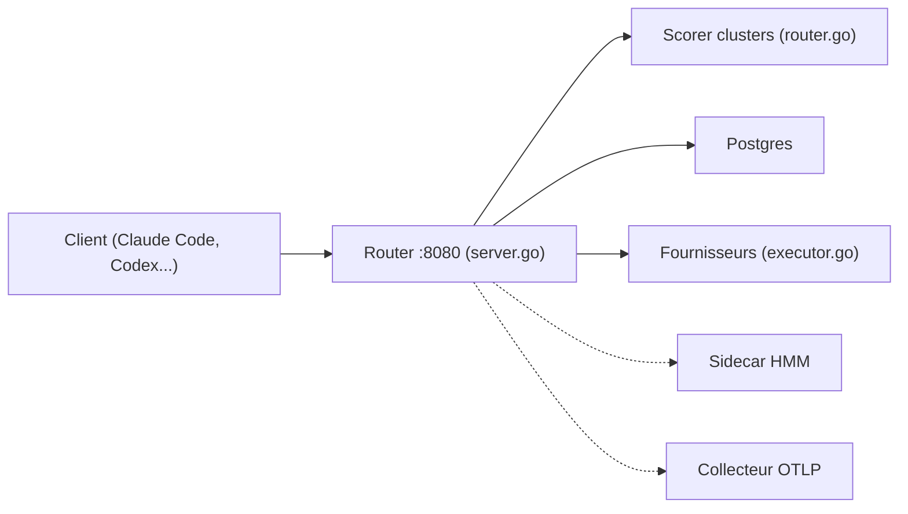

# workweave/router

> Proxy compatible with Anthropic, OpenAI and Gemini that picks a model per request, for coding-agent users.

## The problem
Manually choosing the model for each task is costly or degrades quality; each client speaks a different API format.

## What it actually does
A router listens on `localhost:8080` and exposes Anthropic Messages, OpenAI Chat Completions and Gemini. A cluster-based scorer (inspired by Avengers-Pro, embedded ONNX embedder) picks the model among the enabled providers, per action. An HMM sidecar is optional. Postgres stores `rk_` keys, encrypted BYOK keys and usage; OTLP traces; self-hosted dashboard. An npm installer configures Claude Code, Codex, opencode or pi.

## How it is wired


## Trying it
```bash
npx @weave-os/router
echo "OPENROUTER_API_KEY=sk-or-v1-..." >> .env.local
echo "ROUTER_ADMIN_PASSWORD=..." >> .env.local
make full-setup
```

## Cost and gotchas
You pay the upstream providers; the "hosted" mode goes through Weave. Self-hosting: Postgres and Docker. Multi-replica: Pub/Sub required. The HMM sidecar requires a Google key.

## What it is not
Not a model: a routing layer. Cursor support is announced as beta. The announced savings cannot be verified from the README alone.

## Alternatives
OpenRouter (cited as a basis for open source models); not documented for others.

## For you
Watch if you consume a lot of LLM APIs through coding agents: cost-based routing is concrete, but validate quality on your tasks before delegating to it.
