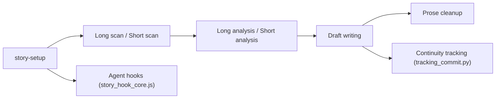

# worldwonderer/oh-story-claudecode

> A pack of 13 skills for writing web novels with a coding agent, aimed at Chinese authors.

## The problem
A long novel written with an agent quickly loses the thread: forgotten plot threads, characters who know too much, a tone that sounds "AI".

## What it actually does
Installs 13 skills covering ranking scans, text analysis, long and short writing, manuscript import, proofreading, "de-AI" and cover art. Memory goes through files: a single `_tracking-state.json` generates the tracking views (context, plots, characters). Hooks block writing a chapter without a detailed outline; lint scripts spot typical AI turns of phrase and check word counts. No GPU required: the model is the host agent's. Documentation in Chinese.

## How it is wired


## Trying it
```bash
npx skills add zenstory-ai/oh-story-claudecode -y -g
```
Then `/story-setup` at the root of the writing project and open a new session.

## Cost and gotchas
The host agent's tokens are at your expense; the cover skill (`story-cover`) calls GPT-Image-2. You must rerun `/story-setup` after each update.

## What it is not
Not an autonomous novel generator nor a way to get around AI detectors: the README says it aims at readability.

## Alternatives
No alternative is named in the README.

## For you
Worth watching: file-based memory management and control gates are a good agent orchestration model, even though the domain (Chinese web novels) is far from yours.
