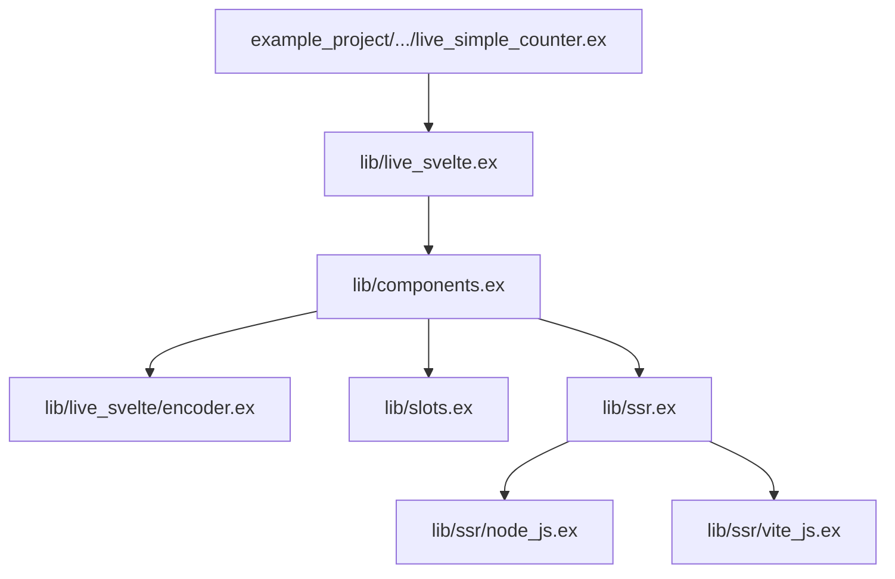

# woutdp/live_svelte

> Embeds Svelte components in Phoenix LiveView with server-side rendering, for Elixir developers.

## The problem
LiveView handles complex client-side local state poorly; writing JavaScript by hand alongside it disconnects the state from the server.

## What it actually does
A LiveView calls a Svelte component via lib/components.ex, which encodes the props, handles slots, then delegates server-side rendering to lib/ssr.ex (NodeJS in production, Vite in development). Props are updated over the LiveView websocket, and the client can send events back to the server. A `~V` sigil lets you write a LiveView in Svelte.

## How it is wired


## Trying it
```bash
mix archive.install hex igniter_new
mix igniter.new my_app --with phx.new --install live_svelte
cd my_app
mix setup
mix phx.server
```

## Cost and gotchas
Free. Node 19+ is required for server-side rendering, including in production; you must set NODE_ENV=production or it leaks memory. Requires Phoenix 1.8+, Elixir 1.17+ and OTP 27+.

## What it is not
Not a standalone framework: it assumes an existing Phoenix application and does not replace LiveView.

## Alternatives
Surface UI is cited as the inspiration for the sigil.

## For you
Ignore: only useful if you write Phoenix LiveView, which is not your data, AI or MLOps work.
