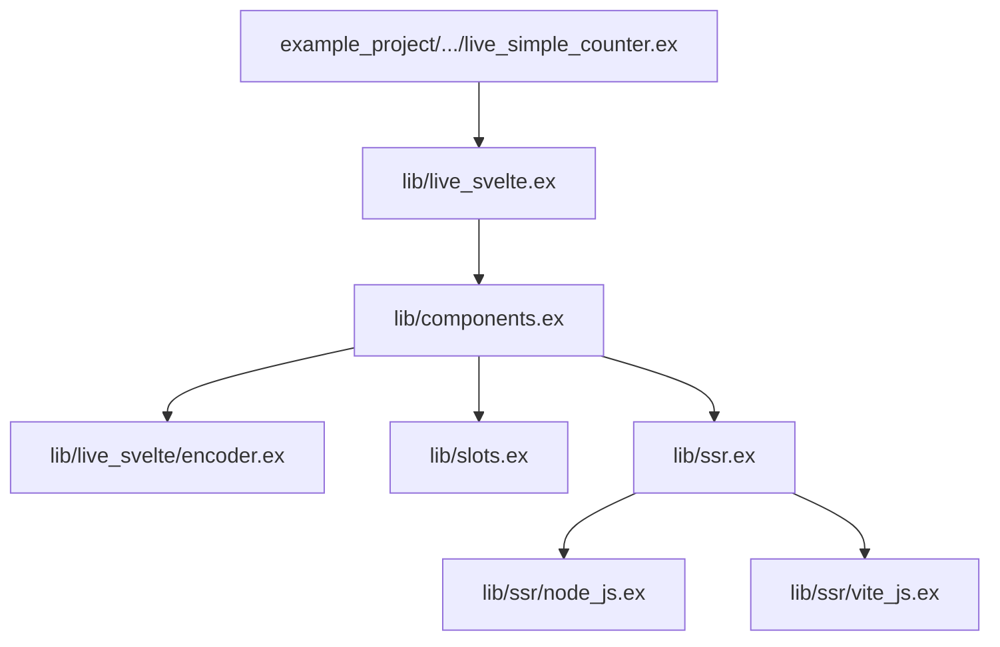

# woutdp/live_svelte

> Intègre des composants Svelte dans Phoenix LiveView avec rendu serveur, pour les développeurs Elixir.

## Le problème
LiveView gère mal l'état local complexe côté client ; écrire du JavaScript à la main à côté déconnecte l'état du serveur.

## Ce que ça fait vraiment
Un LiveView appelle un composant Svelte via lib/components.ex, qui encode les props, gère les slots, puis délègue le rendu serveur à lib/ssr.ex (NodeJS en production, Vite en développement). Les props se mettent à jour par la websocket LiveView, et le client peut renvoyer des événements au serveur. Un sigil `~V` permet d'écrire un LiveView en Svelte.

## Comment c'est branché


## Essayer
```bash
mix archive.install hex igniter_new
mix igniter.new my_app --with phx.new --install live_svelte
cd my_app
mix setup
mix phx.server
```

## Coût et pièges
Gratuit. Node 19+ requis pour le rendu serveur, y compris en production ; il faut mettre NODE_ENV=production sinon fuite mémoire. Exige Phoenix 1.8+, Elixir 1.17+ et OTP 27+.

## Ce que ce n'est pas
Ce n'est pas un framework à part : il suppose une application Phoenix existante et ne remplace pas LiveView.

## Alternatives
Surface UI est citée comme source d'inspiration du sigil.

## Pour toi
À ignorer : utile seulement si tu écris du Phoenix LiveView, ce qui n'est pas ton métier data, IA ou MLOps.

