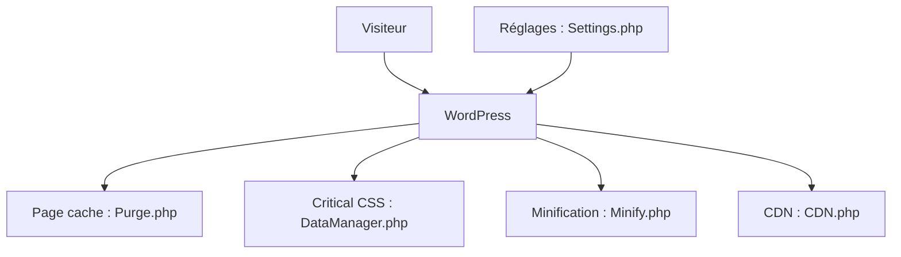

# wp-media/wp-rocket

> WordPress caching and performance optimization plugin, for site owners.

## The problem
An unoptimized WordPress site loads slowly: regenerated pages, heavy resources, off-screen images.

## What it actually does
The plugin caches and purges pages, minifies resources, lazy-loads images and handles critical CSS. It drives a CDN, integrates with Cloudflare, Varnish and WP Engine, and offers insights tests with a task queue.

## How it is wired


## Trying it
```bash
composer require wp-media/wp-rocket
cd wp-content/plugins/wp-rocket/
composer install --no-dev --no-scripts
npm ci
npm run build:js && npm run build:css
```

## Cost and gotchas
The plugin is commercial: you must set `WP_ROCKET_EMAIL` and `WP_ROCKET_KEY` in `wp-config.php` to validate the license. Building the assets requires Node `^22.18.0 || >=24.11.0`.

## What it is not
This repository is not a support channel: bugs only. The code is visible but use remains tied to a paid account.

## Alternatives
No alternative cited in the README.

## For you
Ignore: commercial WordPress tool, outside your data / AI / MLOps scope.
