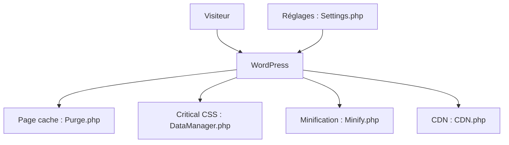

# wp-media/wp-rocket

> Extension WordPress de cache et d'optimisation de performance, pour les propriétaires de sites.

## Le problème
Un site WordPress non optimisé charge lentement : pages régénérées, ressources lourdes, images hors écran.

## Ce que ça fait vraiment
Le plugin met les pages en cache et les purge, minifie les ressources, charge les images en différé et gère le CSS critique. Il pilote un CDN, s'intègre à Cloudflare, Varnish et WP Engine, et propose des tests d'insights avec une file de tâches.

## Comment c'est branché


## Essayer
```bash
composer require wp-media/wp-rocket
cd wp-content/plugins/wp-rocket/
composer install --no-dev --no-scripts
npm ci
npm run build:js && npm run build:css
```

## Coût et pièges
Le plugin est commercial : il faut définir `WP_ROCKET_EMAIL` et `WP_ROCKET_KEY` dans `wp-config.php` pour valider la licence. Construire les assets demande Node `^22.18.0 || >=24.11.0`.

## Ce que ce n'est pas
Ce dépôt n'est pas un canal de support : les bugs seulement. Le code est visible mais l'usage reste lié à un compte payant.

## Alternatives
Aucune alternative citée dans le README.

## Pour toi
À ignorer : outil WordPress commercial, hors de ton périmètre data / IA / MLOps.

