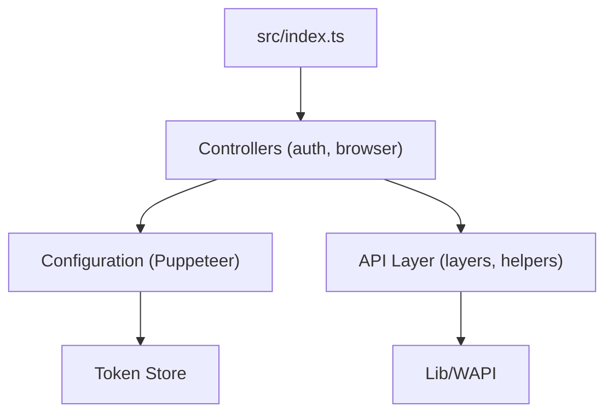

# wppconnect-team/wppconnect

> Node.js library that drives WhatsApp Web through an automated browser, for bots and integrations.

## The problem
WhatsApp offers no simple API for a developer who wants to send and receive messages from their application.

## What it actually does
Drives WhatsApp Web with Puppeteer and exposes a JavaScript/TypeScript API: text, images, videos, documents, contacts, groups, multiple sessions and QR code pairing. A token store keeps the session. The browser-side code (`lib/wapi`) relays WhatsApp Web's functions.

## How it is wired


## Trying it
```bash
npm install @wppconnect-team/wppconnect
node index.cjs
```

## Cost and gotchas
Free, but you need Chrome or Chromium, a WhatsApp account and a QR code scan. Changes to WhatsApp Web can break the library: read the release notes on every update.

## What it is not
Not an official WhatsApp API. No minimum Node version declared. The supplied diagram is a general description of the code, not an exact survey.

## Alternatives
- WPPConnect Server: REST API with webhooks, to expose sessions over HTTP.
- WA-JS: WhatsApp Web functions on the browser side.

## For you
Ignore: a WhatsApp bot tool unrelated to data or AI, and fragile against WhatsApp Web changes.
