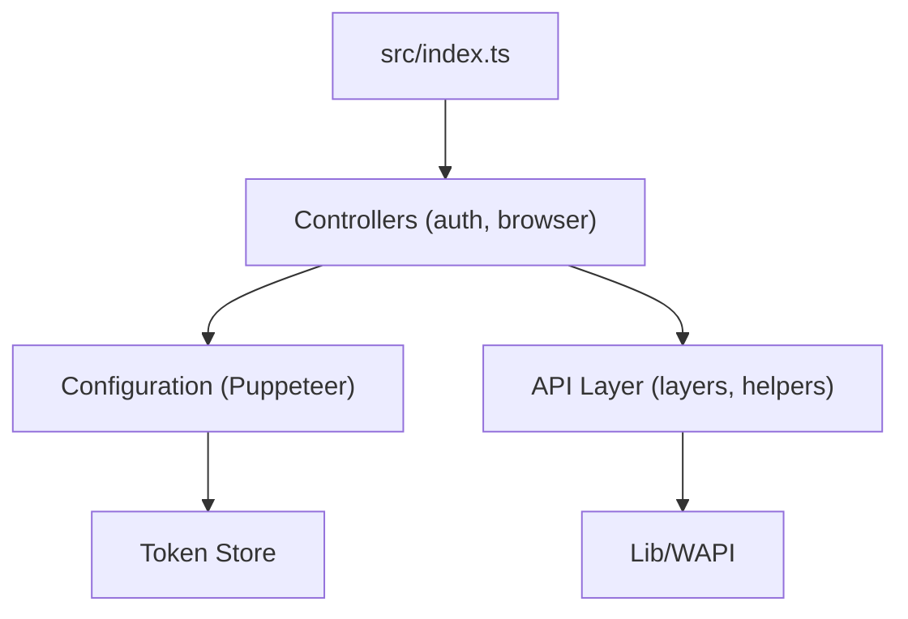

# wppconnect-team/wppconnect

> Bibliothèque Node.js qui pilote WhatsApp Web par navigateur automatisé, pour bots et intégrations.

## Le problème
WhatsApp n'offre pas d'API simple pour un développeur qui veut envoyer et recevoir des messages depuis son application.

## Ce que ça fait vraiment
Pilote WhatsApp Web avec Puppeteer et expose une API JavaScript/TypeScript : textes, images, vidéos, documents, contacts, groupes, sessions multiples et appairage par QR code. Un magasin de jetons conserve la session. Le code côté navigateur (`lib/wapi`) relaie les fonctions de WhatsApp Web.

## Comment c'est branché


## Essayer
```bash
npm install @wppconnect-team/wppconnect
node index.cjs
```

## Coût et pièges
Gratuit, mais il faut Chrome ou Chromium, un compte WhatsApp et le scan d'un QR code. Les changements de WhatsApp Web peuvent casser la bibliothèque : lire les notes de version à chaque mise à jour.

## Ce que ce n'est pas
Pas une API officielle de WhatsApp. Pas de version minimale de Node déclarée. Le diagramme fourni est une description générale du code, pas un relevé exact.

## Alternatives
- WPPConnect Server : API REST avec webhooks, pour exposer les sessions en HTTP.
- WA-JS : fonctions de WhatsApp Web côté navigateur.

## Pour toi
À ignorer : outil de bot WhatsApp sans lien avec la data ou l'IA, et fragile face aux changements de WhatsApp Web.

