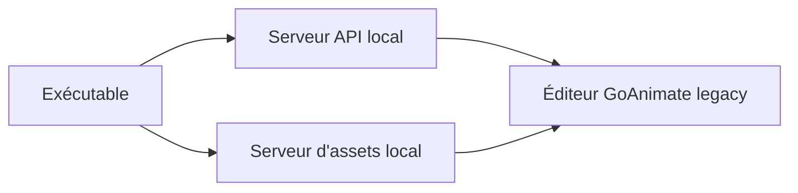

# wrapper-offline/wrapper-offline

> Local application that replays GoAnimate's servers and assets so the old animation editor can be used offline.

## The problem
The old GoAnimate editor and its themes have been withdrawn; without a local archive, they are inaccessible.

## What it actually does
Replicates the original API and asset servers on the user's machine, with a simple interface to use it. Relies on third-party assets (Vyond themes, a character dump) credited in the README.

## How it is wired

Inferred from the README, no diagram provided.

## Trying it
```bash
npm run dev
npm run preview
npm run package
```
For simple use: download the latest release, extract the archive, run the executable.

## Cost and gotchas
Free. Packaging requires manually copying the `resources` folder. 175 open issues.

## What it is not
Not a product of the original authors: the original GoAnimate Wrapper team does not officially work on it. The assets rely on a third party's themes: the code's MIT license does not necessarily cover this content.

## Alternatives
No alternative named in the README.

## For you
Ignore: archiving of an animation tool, outside the data / AI / MLOps scope.
