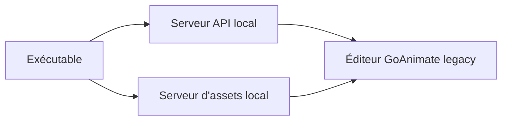

# wrapper-offline/wrapper-offline

> Application locale qui rejoue les serveurs et assets de GoAnimate pour utiliser l'ancien éditeur d'animations hors ligne.

## Le problème
L'ancien éditeur GoAnimate et ses thèmes sont retirés ; sans archive locale, ils sont inaccessibles.

## Ce que ça fait vraiment
Réplique l'API et les serveurs d'assets d'origine sur la machine de l'utilisateur, avec une interface simple pour s'en servir. S'appuie sur des assets d'un tiers (thèmes Vyond, dump de personnages) crédités dans le README.

## Comment c'est branché

Déduit du README, aucun diagramme fourni.

## Essayer
```bash
npm run dev
npm run preview
npm run package
```
Pour l'usage simple : télécharger la dernière release, extraire l'archive, lancer l'exécutable.

## Coût et pièges
Gratuit. Le packaging demande de copier à la main le dossier `resources`. 175 issues ouvertes.

## Ce que ce n'est pas
Pas un produit des auteurs d'origine : l'équipe GoAnimate Wrapper d'origine n'y travaille pas officiellement. Les assets reposent sur des thèmes d'un tiers : la licence MIT du code ne couvre pas forcément ces contenus.

## Alternatives
Aucune alternative nommée dans le README.

## Pour toi
Ignorer : archivage d'un outil d'animation, hors périmètre data / IA / MLOps.

