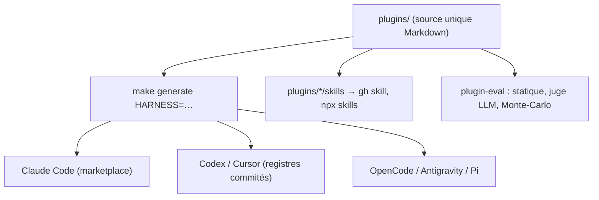

# wshobson/agents

> A marketplace of 94 agent, skill and command plugins for six environments.

## The problem
Useful agents and skills get rewritten for every environment, and loading a whole catalog
drowns the context in definitions of which only a handful are used.

## What it actually does
Keeps a single source in `plugins/` and generates idiomatic artifacts for Claude Code,
Codex CLI, Cursor, OpenCode, Antigravity, Copilot and Pi.
Counts 94 plugins, 202 specialized agents, 183 progressive-disclosure skills, 105 commands and
16 multi-agent orchestrators. Each plugin is isolated: installing it loads only its components.
Assigns one model per tier — Fable 5 for long autonomous work, Opus for architecture
and security, Sonnet for docs and tests, Haiku for fast operations.
Provides `plugin-eval`, a three-layer evaluation framework: static structural analysis,
an LLM judge on four dimensions, and statistical reliability through Monte Carlo over 50 to 100 runs.

## How it is wired


## Trying it
```bash
/plugin marketplace add wshobson/agents
/plugin install python-development
npx codex-marketplace add wshobson/agents
gh skill install wshobson/agents python-testing-patterns --agent claude-code
uv run plugin-eval score path/to/skill --depth quick
```

## Cost and gotchas
Free. `plugin-eval` runs consume tokens: the LLM judge runs on Haiku and
Sonnet, and the Monte Carlo layer needs 2 to 5 minutes of simulations. Two external entries are
pulled from other repos via `git-subdir` (Pensyve, HOL Guard); HOL Guard is pinned to a
specific commit and its installation requires explicit approval, because its CLI can modify
the hooks configuration.

## What it is not
It is not a catalog reviewed by a third party: it is the work of a single maintainer, at high volume.
It is not a set to install wholesale — per-plugin isolation exists precisely for that.
The counters are impressive, but they say nothing about the quality of each definition.

## Alternatives
- **anthropics/claude-plugins-official**: official directory, more limited and filtered.
- **github/awesome-copilot**: the equivalent on the Copilot side.

## For you
Worth digging through for two or three specific skills; `plugin-eval` is the reusable idea of the repo.
